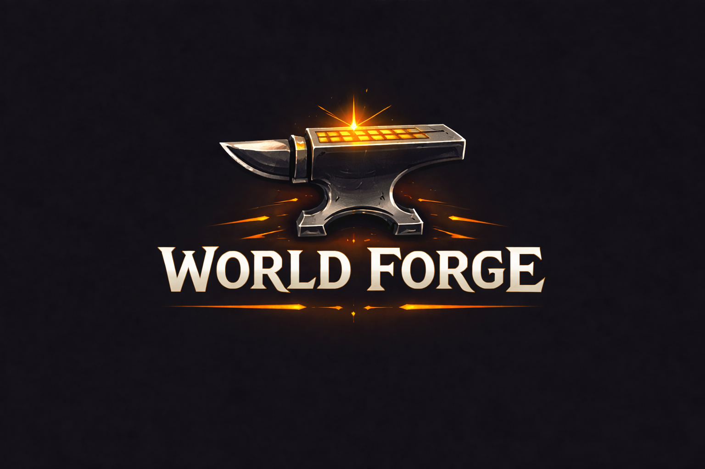
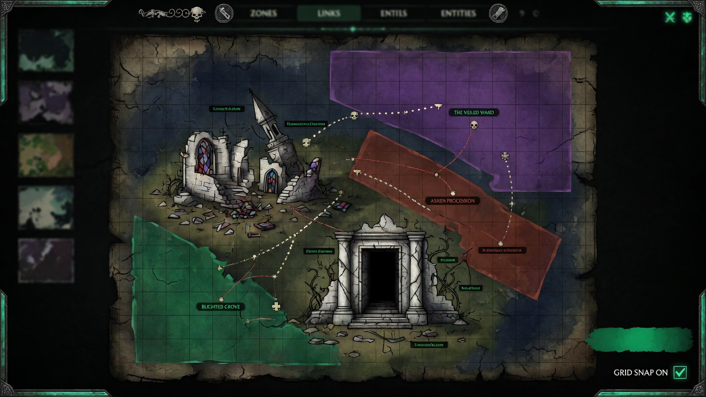

<p align="center">
  <a href="README.ja.md">日本語</a> | <a href="README.zh.md">中文</a> | <a href="README.md">English</a> | <a href="README.fr.md">Français</a> | <a href="README.hi.md">हिन्दी</a> | <a href="README.it.md">Italiano</a> | <a href="README.pt-BR.md">Português (BR)</a>
</p>

<p align="center">
  
</p>

<p align="center">
  
</p>

<p align="center">
  <a href="https://github.com/mcp-tool-shop-org/world-forge/actions/workflows/ci.yml"></a>
  <a href="https://www.npmjs.com/package/@world-forge/schema"></a>
  <a href="https://opensource.org/licenses/MIT"></a>
  <a href="https://mcp-tool-shop-org.github.io/world-forge/"></a>
</p>

<p align="center">2D / 2.5D world authoring studio with peer export lanes for <a href="https://github.com/mcp-tool-shop-org/ai-rpg-engine">AI RPG Engine</a>, <a href="https://www.unrealengine.com/">Unreal Engine 5</a>, and <a href="https://godotengine.org/">Godot 4</a>.<br>One editor, many modes — paint zones, place entities, define districts, export a complete content pack for your engine of choice.</p>

<!-- version:start -->
<p align="center"><strong>v4.9.1</strong> — 3475 tests, 6 shipping packages, 7 authoring modes, tiles + interiors + town authoring + world modeling (vertical strata, typed hazards, party-gated zones), three export targets (AI RPG Engine, Unreal Engine 5, Godot 4), a measured Forge→Engine content contract, and an authored drawing contract for 2.5D clients</p>
<!-- version:end -->

## Arquitectura

```
packages/
  schema/          @world-forge/schema         — spatial types, validation, 2.5D fields
  export-ai-rpg/   @world-forge/export-ai-rpg  — AI RPG Engine export pipeline + CLI
  export-unreal/   @world-forge/export-unreal  — Unreal Engine 5 export pipeline + CLI (2.5D aware)
  export-godot/    @world-forge/export-godot   — Godot 4 export pipeline + .tscn scene generation
  renderer-2d/     @world-forge/renderer-2d    — PixiJS 2D canvas renderer
  editor/          @world-forge/editor         — React web authoring app
```

## Guía de inicio rápido

```bash
npm install
npm run build
npm run dev --workspace=packages/editor
```

Abra `http://localhost:5173` para iniciar el editor.

### Flujo de trabajo del editor

1. **Elija un modo:** mazmorra, distrito, mundo, océano, espacio, interior o naturaleza, para establecer los valores predeterminados de la cuadrícula y el vocabulario de conexión.
2. **Comience con un kit:** elija un kit de inicio o una plantilla de género del Administrador de plantillas, o comience con un proyecto en blanco.
3. **Pinte zonas:** arrastre sobre el lienzo para crear zonas, conéctelas y asigne distritos.
4. **Coloque entidades:** agregue PNJ, enemigos, comerciantes, encuentros y objetos a las zonas.
5. **Revise:** abra la pestaña de revisión para ver el estado de salud, la descripción general del contenido y la exportación resumida (Markdown/JSON).
6. **Exporte:** abra el modal de exportación para ver el estado de preparación por destino (✓ Listo / ⚠ advertencias), configure las opciones de destino y luego descargue AI RPG Engine, UE5 o los paquetes de Godot 4. Los recibos posteriores a la exportación se acumulan con detalles de tamaño, recuento y fidelidad. También: paquetes de proyectos (.wfproject.json) y resúmenes de revisión.

### Exportación desde la línea de comandos (CLI)

```bash
# AI RPG Engine
npx world-forge-export project.json --out ./my-pack
npx world-forge-export project.json --validate-only
npx world-forge-export --import ./my-pack --out ./round-trip

# Unreal Engine 5
npx world-forge-export-unreal project.json --out ./UnrealPack --sign
npx world-forge-export-unreal --summary ./UnrealPack

# Godot 4 — writes a loadable project root (project.godot + world.tscn)
npx world-forge-export-godot project.json --out ./GodotPack
npx world-forge-export-godot project.json --validate-only
```

## Paquetes

### @world-forge/schema

Tipos y validación principales TypeScript para la creación de mundos.

- **Tipos espaciales:** `WorldMap`, `Zone`, `ZoneConnection`, `District`, `Landmark`, `SpawnPoint`, `EncounterAnchor`, `FactionPresence`, `PressureHotspot`
- **Tipos de contenido:** `EntityPlacement`, `ItemPlacement`, `DialogueDefinition`, `PlayerTemplate`, `BuildCatalogDefinition`, `ProgressionTreeDefinition`
- **Capas visuales:** `AssetEntry`, `AssetPack`, `Tileset`, `TileLayer`, `PropDefinition`, `PropPlacement`, `AmbientLayer`
- **Ciudad + estructuras:** `MarketNode`, `CraftingStation`, `Building`, `Hub`, `Stronghold`
- **Modelado del mundo:** `Stratum` + `StratumLink` (capas verticales), `HazardDefinition` (unión de efectos tipados), `ZoneEntryGate` + operandos de estado de grupo `SpawnCondition` (`party-level`, `party-size`, `item`, `flag`, `member`, `class`)
- **Sistema de modo:** `AuthoringMode` (7 modos), perfiles de cuadrícula/conexión/validación específicos del modo
- **Presentación:** opcional `WorldPresentation` en `WorldProject`: vista dimétrica, huella de mosaico, celdas de anclaje de zona, planos de piso y una fila de ocupación por actor. `presentationAdvisories()` ejecuta ocho reglas de advertencia sobre ella, incluida la que importa: una persona dibujada en una habitación, la simulación la coloca fuera de ella.
- **Validación:** `validateProject()` (89 comprobaciones estructurales con búsquedas O(n) basadas en mapas, `warningCount`), `advisoryValidation()` (sugerencias específicas del modo, integridad de los metadatos, nombres de los activos). v4.0 JSON que omite las matrices requeridas posteriormente se acepta después de `normalizeProjectShape()` / `stampProjectSchemaVersion()`.
- **Uniones cerradas en el conjunto:** `VALID_CONNECTION_KINDS`, `VALID_ASSET_KINDS`, `VALID_ENTITY_ROLES`, `VALID_ITEM_SLOTS` y el resto de los conjuntos `VALID_*` se exportan desde `@world-forge/schema`.
- **Utilidades:** `assembleSceneData()` (enlaces visuales con detección de activos faltantes), `scanDependencies()` (análisis del gráfico de referencias), `buildReviewSnapshot()` (clasificación de la salud)

### @world-forge/export-unreal

Convierte un `WorldProject` en un paquete de contenido de Unreal Engine 5 optimizado para juegos 2.5D.

- **Salida:** `pack.json`, JSON de activos de datos primarios por zona y por distrito, manifiesto de generación de actores agrupados, sugerencias de transmisión de niveles por conexión, sugerencias de celdas de partición mundial y un informe de fidelidad estructurado.
- **Campos 2.5D:** `Zone.elevation`, `elevationRange`, `parallaxLayers`, `skylineRef` se conservan y se convierten en coordenadas UE cm / Z-up.
- **Transformación de coordenadas:** funciones puras (`pixelsToUnrealCm`, `elevationToZ`, `worldForgeToUnrealAxis`, `gridToUnrealAxis`). La escala mundial predeterminada es 1 mosaico = 100 cm.
- **Importación de ida y vuelta:** `importFromUnreal` reconstruye un WorldProject a partir de un paquete de Unreal; los datos solo para el juego (diálogos, progresión, construcciones) se marcan como eliminados en el informe de fidelidad.
- **CLI:** `world-forge-export-unreal` con `--out`, `--tile-size-cm`, `--validate-only`, `--verbose`.

### @world-forge/export-godot

Convierte un `WorldProject` en un paquete de contenido de Godot 4 con texto de escena `.tscn`.

- **Salida:** una raíz de proyecto de Godot 4: `project.godot`, `world.tscn` (ExtResource `.tres`), texturas copiadas en `assets/`, `scripts/player.gd`, más `pack.json` y `fidelity.json`
- **CLI:** `world-forge-export-godot` con `--out`, `--validate-only`, `--include-world-tscn` / `--no-world-tscn`
- **Escena jugable:** `buildWorldScene()` emite una `.tscn` navegable: colisión `StaticBody2D` por zona + `NavigationRegion2D`, un `Camera2D` enmarcado, un `CharacterBody2D` de jugador y clasificación y profundidad `z_index`.
- **Mosaicos + interiores:** `TileMapLayer` + `TileSet` (`tile_map_data` horneado para conjuntos de mosaicos de imagen), colisión de pared por celda `StaticBody2D` y colocación de accesorios `Node2D`.
- **Ciudad:** mercados + estaciones de artesanía y edificios (huellas `StaticBody2D`) / centros / fortalezas como marcadores de posición `Node2D`, todos los cuales llevan sus datos como metadatos.
- **Modelado del mundo:** estratos verticales (bandas `z_index` por zona + `StratumLink` conectores), peligros tipados como regiones `Area2D` y metadatos de entrada de zona.
- **Informe de fidelidad:** seguimiento estructurado de los datos sin pérdidas, aproximados y eliminados, verificados con el motor real de Godot 4 (humo sin conexión, 36 aserciones).
- **Advertencias de presentación:** se transmite un bloque `presentation` creado sin cambios y sus advertencias se muestran en `warnings[]`, por lo que un desacuerdo entre el dibujo y la simulación es un hallazgo de exportación en lugar de una sorpresa en la pantalla.
- **Versión del formato:** `GODOT_PACK_FORMAT_VERSION` 1.1.0 (`files`, `zoneGates`, `migrateGodotPack`)

### @world-forge/export-ai-rpg

Convierte un `WorldProject` en el formato `ContentPack` de ai-rpg-engine.

- **Exportación:** zonas, distritos, entidades, objetos, diálogos, plantilla de jugador, catálogo de construcciones, árboles de progresión, encuentros, facciones, puntos calientes, manifiesto y metadatos del paquete.
- **Importación:** 8 convertidores inversos reconstruyen un WorldProject a partir del JSON exportado; CLI `--import` / `--from-pack` escribe `world-project.json` (o stdout).
- **Informe de fidelidad:** seguimiento estructurado de lo que se conservó sin pérdidas, se aproximó o se eliminó durante la conversión; `--out` escribe `fidelity.json` junto con el paquete.
- **Detección de formato:** detecta automáticamente los formatos WorldProject, ExportResult, ContentPack y ProjectBundle.
- **CLI:** `world-forge-export` con `--out`, `--import`, `--from-pack`, `--validate-only`, `--dry-run` y `--verbose`.

### @world-forge/renderer-2d

Motor de renderizado 2D basado en PixiJS: ventana con panorámica/zoom, superposiciones de zona con coloración de distrito, flechas de conexión, iconos de entidad por rol, capas de mosaico y un minimapa.

Un motor de renderizado independiente publicado para que los consumidores externos incrusten los datos de World Forge en su propia aplicación PixiJS. **El editor no lo utiliza:** el lienzo del editor es una implementación Canvas2D directa, por lo que las funciones de minimapa y ventana que se enumeran a continuación en el editor son propias, no de este paquete.

### @world-forge/editor

Aplicación web React 19 + Vite con administración de estado de Zustand, deshacer/rehacer con etiquetas de acción, guardado automático (retardo de 30 segundos, historial de 3 versiones, recuperación de fallos), protecciones de estado sucio en todos los caminos de carga del proyecto, alternancia de temas claro/oscuro, trampas de enfoque modal y cambio de herramientas basado en el teclado.

#### Pestañas del espacio de trabajo

| Pestaña | Propósito |
|-----|---------|
| Mapa | Edición de zonas/entidades/distritos en el lienzo 2D |
| Objetos | Árbol jerárquico: distritos → zonas → entidades/puntos de referencia/puntos de aparición |
| Jugador | Plantilla de jugador con estadísticas, inventario, equipo, punto de aparición |
| Configuraciones | Arquetipos, antecedentes, rasgos, disciplinas, combinaciones |
| Árboles | Nodos de progresión con requisitos y efectos |
| Diálogo | Edición de nodos, enlace de opciones, detección de referencias rotas |
| Preajustes | Navegador de preajustes de región y encuentros con fusión/reescritura |
| Activos | Biblioteca de activos con búsqueda filtrada por tipo, detección de activos huérfanos, paquetes de activos |
| Problemas | Validación agrupada en vivo con navegación de clic para enfocar |
| Dependencias | Escáner de dependencias con botones de reparación en línea |
| Revisión | Panel de control de estado, descripción general del contenido, exportación de resumen |
| Guía | Lista de verificación para el primer uso con referencia de teclas de acceso rápido |

#### Lienzo y edición

- **Herramientas:** seleccionar, pintar zonas, conectar, colocar entidades, punto de referencia, punto de aparición, colocar objetos, colocar encuentros
- **Selección múltiple:** clic con Mayús, selección con el ratón, Ctrl+A; mover con arrastrar y deshacer atómico
- **Alineación:** alineación de 6 vías (izquierda/derecha/arriba/abajo/centro horizontal/centro vertical) y distribución horizontal/vertical
- **Ajuste:** ajuste al arrastrar a los bordes/centros de los objetos cercanos con líneas guía visuales
- **Redimensionar:** 8 controladores por zona con ajuste a los bordes, limitación del tamaño mínimo, vista previa en vivo
- **Duplicar:** Ctrl+D con ID, conexiones y asignaciones de distritos reasignados
- **Copiar/Pegar:** Ctrl+C / Ctrl+V con reasignación de ID y desplazamiento configurable
- **Ciclo de clics:** clics repetidos en la misma posición para recorrer los objetos superpuestos
- **Menú contextual:** clic derecho para 7 acciones sensibles al contexto (propiedades, eliminar, duplicar, etc.)
- **Vista previa de la conexión:** línea cian discontinua durante la colocación de la herramienta de conexión
- **Minimapa:** vista general de 200×150 (esquina inferior derecha), hacer clic para saltar
- **Eliminación de la vista:** solo renderiza los objetos dentro de los límites visibles (margen de 64 píxeles)
- **Estadísticas de rendimiento:** alternar superposición de FPS/recuento de objetos/tiempo de renderizado
- **Visibilidad por objeto:** ocultar/mostrar objetos individuales (guardado en localStorage)
- **Capas:** alternar la visibilidad (cuadrícula, conexiones, entidades, puntos de referencia, puntos de aparición, ciudad, mosaicos, accesorios, ambiente; los objetos interactúan con la capa de objetos)

#### Navegación y atajos

- **Vista:** panorámica/zoom de la cámara, zoom con la rueda del ratón (anclado al cursor), arrastrar con la barra espaciadora/botón central del ratón/clic derecho, ajuste automático al contenido, doble clic para centrar
- **Buscar:** Ctrl+K abre una superposición para encontrar cualquier objeto por nombre/ID con coincidencia aproximada, navegación con el teclado y historial de búsqueda reciente (localStorage)
- **Panel de velocidad:** doble clic derecho para una paleta de comandos flotante con acciones sensibles al contexto, favoritos anclables, macros y acciones rápidas sugeridas por el modo
- **Teclas de acceso rápido:** 21 atajos de teclado, incluidos el cambio de herramientas (V/Z/C/E/L/S), Enter (abrir detalles), P (aplicar preajuste), Mayús+P (guardar preajuste), Ctrl+C/V (copiar/pegar), ajuste con las flechas (Mayús = 5×)
- **Accesibilidad:** trampas de enfoque modales con Escape para cerrar, etiquetas ARIA en todos los botones con solo iconos, árbol de objetos navegable con el teclado, indicador de cambios anunciado por un lector de pantalla. Las operaciones de lienzo espacial (colocación, selección con el ratón, redimensionamiento, dibujo de conexiones, panorámica) siguen siendo basadas en el puntero

#### Importación y exportación

- **ContentPack:** exportación con conocimiento del destino a AI RPG Engine, Unreal Engine 5 o Godot 4 con indicadores de preparación por destino, opciones configurables (tamaño del mosaico, prefijos de escena, filtrado de paquetes) y recibos posteriores a la descarga
- **Paquetes de proyecto:** archivos `.wfproject.json` portátiles con metadatos de procedencia e información de dependencia
- **Paquetes de herramientas:** exportación/importación `.wfkit.json` con validación, manejo de colisiones y seguimiento de la procedencia
- **Importar:** detecta automáticamente 4 formatos con informes de fidelidad estructurados
- **Diferencia:** seguimiento de cambios semánticos desde la importación
- **Vista previa de la escena:** composición HTML/CSS en línea de todas las vinculaciones visuales de la zona

## Modos de creación

World Forge separa el **género** (fantasía, cyberpunk, pirata) del **modo** (mazmorra, océano, espacio). El género es el sabor; el modo es la escala. El modo rige los valores predeterminados de la cuadrícula, el vocabulario de la conexión, las sugerencias de validación, la redacción de la guía y el filtrado de los preajustes.

| Modo | Cuadrícula | Mosaico | Conexiones clave |
|------|------|------|-----------------|
| Mazmorra | 30×25 | 32 | puerta, escaleras, pasaje, secreto, peligro |
| Distrito/Ciudad | 50×40 | 32 | carretera, puerta, pasaje, portal |
| Región/Mundo | 80×60 | 48 | carretera, portal, pasaje |
| Océano/Mar | 60×50 | 48 | canal, ruta, portal, peligro |
| Espacio | 100×80 | 64 | acoplamiento, salto, pasaje, portal |
| Interior | 20×15 | 24 | puerta, escaleras, pasaje, secreto |
| Tierra salvaje | 60×50 | 48 | sendero, carretera, pasaje, peligro |

El modo se establece al crear un proyecto y se guarda como `mode?: AuthoringMode` en `WorldProject`. Cada modo proporciona **valores predeterminados inteligentes**: los tipos de conexión, los roles de las entidades, los nombres de las zonas y las sugerencias del Panel de velocidad se adaptan automáticamente.

## Superficie de creación

### Estructura del mundo

- Zonas con diseño espacial, vecinos, salidas, iluminación, ruido, peligros y elementos interactivos.
- 12 tipos de conexión (pasaje, puerta, escalera, camino, portal, secreto, peligro, canal, ruta, muelle, teletransporte, sendero) con estilos visuales distintos, enrutamiento anclado a los bordes, flechas direccionales y estilos discontinuos condicionales.
- Distritos con control de facciones, perfiles económicos, controles deslizantes de métricas, etiquetas y etiquetas de nombre de distrito en los centroides de las zonas.
- Puntos de referencia (puntos de interés con nombre dentro de las zonas).
- Puntos de aparición, anclajes de encuentros (coloreado basado en el tipo), presencia de facciones y puntos críticos de presión.
- **Estratos verticales:** capas discretas (superficie/subterráneo/cielo, o pisos de un edificio) con orden, rango z, visibilidad entre capas y conectores (escaleras/escaleras de mano/ascensores) definidos; las zonas se asignan a un estrato.
- **Peligros ambientales tipificados:** una biblioteca de peligros compartida (efectos de daño/estado/muerte instantánea/ignición, tiempo de activación, costo de movimiento del terreno, transitabilidad, bloqueo de la visión, condiciones climáticas) referenciada por zona.
- **Puertas de entrada de zona para grupos:** entrada de puerta basada en el estado del grupo (nivel/tamaño/objetos/indicadores/miembros/clases) como una puerta estricta o una puerta informativa con una razón de "mostrar la cerradura" definida.
- **Ocupación de presentación:** para clientes 2.5D: una vista dimétrica con una huella de mosaico y un rango, una celda de anclaje y una placa de piso opcional por zona, y una fila de ocupación (paquete de personajes, zona, celda, orientación) por actor, incluido el jugador.

### Contenido

- Colocación de entidades con estadísticas, recursos, perfiles de IA y metadatos personalizados.
- Colocación de objetos con ranura, rareza, modificadores de estadísticas y habilidades otorgadas.
- Árboles de diálogo con conversaciones ramificadas, condiciones y efectos.
- Anclajes de encuentros en el lienzo: marcadores de diamante rojo con tipos de jefe/emboscada/patrulla.

### Ciudad e Interiores

- Pintura de mosaicos: conjuntos de mosaicos basados en imágenes (división por fila/columna) con una alternativa de rectángulo de color, un pincel de arrastre, capas y "Sólido" de transitabilidad por mosaico para la colisión de paredes.
- Colocación de objetos para interiores (paleta + renderizado en el lienzo), con una herramienta de colocación.
- Economía de la ciudad: nodos de mercado (categorías de suministro, modificador de precio, contrabando) y estaciones de creación (tipo de estación, recetas), editados por zona.
- Estructuras de la ciudad: edificios (huellas transitables con un enlace a la zona interior), centros (nodos de servicio y conectividad) y fortalezas (sedes de facciones fortificadas).

### Sistemas de Personajes

- Plantilla de jugador (estadísticas iniciales, inventario, equipo, punto de aparición).
- Catálogo de construcción (arquetipos, antecedentes, rasgos, disciplinas, títulos cruzados, relaciones).
- Árboles de progresión (nodos de habilidad/capacidad con requisitos y efectos).

### Activos

- Manifiesto de activos (retratos, sprites, fondos, iconos, conjuntos de mosaicos) con enlaces específicos del tipo.
- Paquetes de activos (agrupaciones con nombre y versión con metadatos de compatibilidad, tema, licencia).
- Vista previa de la escena (composición en línea de todos los enlaces visuales de la zona con detección de activos faltantes).

### Flujo de trabajo

- Presets de región (9 integrados, filtrados por modo) y presets de encuentro (10 integrados) con aplicación de fusión/reemplazo y CRUD de presets personalizados.
- Kits de inicio (7 integrados, específicos del modo) con exportación/importación de kits (`.wfkit.json`), manejo de colisiones y seguimiento de la procedencia.
- Plantillas de diseño (6 arreglos de zona preconstruidos) y plantillas de diálogo (5 iniciadores de conversación).
- Fusión de zonas y colocación de entidades por lotes (patrones de cuadrícula/aleatorio/círculo).
- Guardado automático con un retraso de 30 segundos y un historial de recuperación de 3 versiones.
- Búsqueda con Ctrl+K en todos los tipos de objetos con coincidencia difusa y historial reciente.
- Paleta de comandos del Panel de velocidad con favoritos anclables, macros, grupos personalizados y sugerencias de modo.
- 21 atajos de teclado centralizados (incluidas 6 teclas de cambio de herramienta).
- Editor de metadatos del proyecto (autor, licencia, categoría, etiquetas).
- Estadísticas de revisión (distribución de roles, tipos de conexión, tipos de encuentro, zonas por distrito).
- Exportación a ContentPack JSON, paquetes de proyecto y resúmenes de revisión.
- Importación desde 4 formatos con informes de fidelidad estructurados, sugerencias de reparación y seguimiento de diferencias semánticas.

Consulte [`dogfood/WALKTHROUGH.md`](dogfood/WALKTHROUGH.md) para el protocolo de exportación de Chapel Threshold que demuestra la superficie actual.

## Directorio de Pruebas Internas

El directorio `dogfood/` contiene un conjunto de pruebas de integración que ejercita todo el flujo de trabajo de creación a exportación fuera de las pruebas unitarias. El ejemplo de Chapel Threshold (`chapel-threshold.ts`) crea un proyecto mundial pequeño pero completo, lo ejecuta a través de la exportación y escribe la salida en `dogfood/output/`. Esto demuestra que los tipos de esquema, la validación y el flujo de trabajo de exportación funcionan de extremo a extremo con datos reales, y no solo con simulacros aislados.

## Compatibilidad con el Motor

Las exportaciones tienen como objetivo tres motores:

- **[ai-rpg-engine](https://github.com/mcp-tool-shop-org/ai-rpg-engine)** — ContentPack formato: el entorno de ejecución de simulación determinista que carga un paquete exportado y ejecuta el mundo.
- **Unreal Engine 5:** paquete de contenido compatible con 2.5D con activos de datos primarios, manifiestos de aparición de actores y sugerencias de partición mundial.
- **Godot 4:** generación de escenas `.tscn` con recursos de zona, enlaces de navegación y manifiestos de entidades.

### El contrato de contenido Forge→Motor

Un exportador que se ejecuta no es lo mismo que un mundo que se inicia. v4.6.0 cierra
esa brecha para la vía del motor AI RPG, y —más útilmente— hace que la brecha restante
sea un número en lugar de una suposición.

- **Una tabla de exportación controlada** (`docs/c0-alignment/`) — un recorrido por la ruta de las hojas que examina cada campo definido y registra cuáles llegan realmente al entorno de ejecución. Se genera, se incluye en el control de versiones y se verifica en cada ejecución de prueba, por lo que "lo que sobrevive a la exportación" puede ser auditado en lugar de simplemente afirmado.
- **Un manifiesto honesto:** el paquete emitido contiene un rango de versiones semánticas del motor real, identificadores de módulos reales, un hash de contenido y condiciones de salida compiladas. Los identificadores de módulos se basan en el contenido real: un paquete sin estaciones de fabricación ya no reclama el módulo de fabricación.
- **El vocabulario espacial se cruza:** las ubicaciones por entidad con condiciones de generación compiladas, peligros tipificados, puertas de entrada y descriptores de escena llegan al paquete de contenido del motor, no solo al esquema.
- **El informe de fidelidad mantiene el contrato.** Cada canal informa qué se conservó sin pérdidas, qué se aproximó o qué se eliminó. Cuando un campo no puede ser incluido, la exportación lo indica; no tiene éxito silenciosamente.

Requiere `ai-rpg-engine` `^3.8.0`.

### El contrato de renderizado

Un mundo también puede indicar cómo debe un cliente **renderizarlo**. `WorldProject.presentation` es opcional y aditivo; la mayoría de los mundos no lo tienen y no se les penaliza por ello, y contiene la vista dimétrica, la huella de la tesela, una celda de anclaje de zona y una placa de suelo por zona, y una fila de ocupación por actor.

Existe porque un mundo 2.5D se describe mediante tres cuadrículas a la vez, y la exportación convierte entre **ninguna** de ellas:

| Cuadrícula | Unidad | Propietario | Hash |
|---|---|---|---|
| Ocupación simulada | ID de zona | el `WorldState` del motor | sí, es la fuente de verdad |
| Celda dimétrica | Diamante de 256x128, con un alcance de 3 | la vista del cliente, a través de `presentation` | nunca |
| Cartesiano de Forge | `gridX` / `gridY` | el editor y el `.tscn` de Godot | nunca |

Una celda dimétrica nunca se deriva de `gridX`/`gridY`, y la escala del entorno de pruebas omite el bloque por nombre, por lo que una celda de diamante absoluta no puede multiplicarse accidentalmente. La simulación siempre gana una disputa sobre en qué habitación se encuentra una persona; `presentationAdvisories()` lo dice en voz alta, `exportToGodot` lo informa en `warnings[]`, y el canal de elementos escénicos puede hacerlo fatal con `--strict`.

El bloque se mueve a través del `pack.json` del elemento escénico de Godot. **No** se mueve a través del canal `export-ai-rpg`; el `ContentPack` del motor no tiene una ranura aditiva y su cargador es estricto, y la tabla de exportación controlada lo informa como eliminado allí en lugar de implicar lo contrario.

## Seguridad

- **Datos afectados:** archivos de proyecto en el disco local (JSON creado por el usuario), sin almacenamiento en el servidor
- **Datos NO afectados:** sin telemetría, sin análisis, sin solicitudes de red más allá del servidor de desarrollo local
- **Permisos:** sin claves de API, sin secretos, sin credenciales
- **No hay secretos, tokens ni credenciales en el código fuente**

## Licencia

MIT

---

Creado por [MCP Tool Shop](https://mcp-tool-shop.github.io/)
