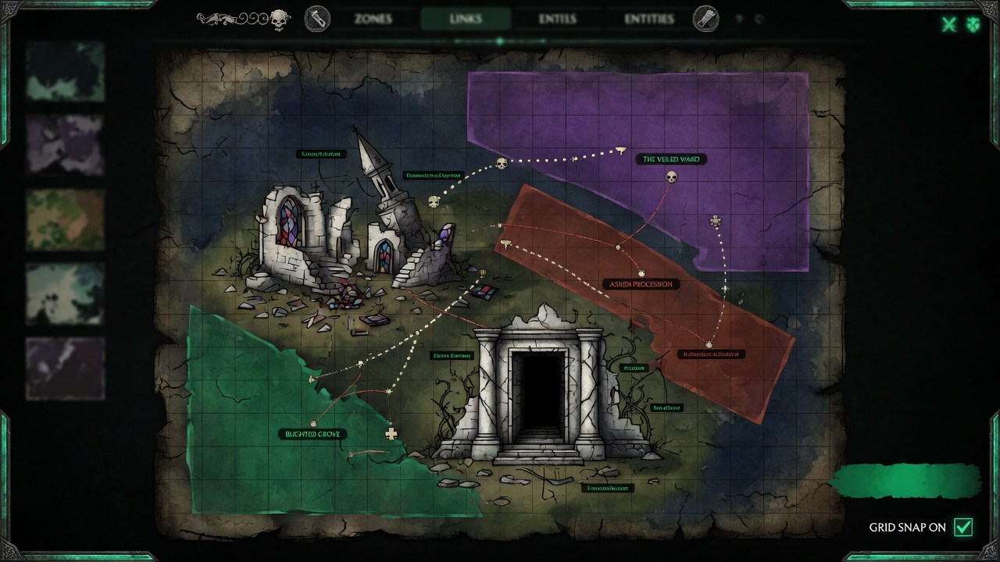

<p align="center">
  <a href="README.ja.md">日本語</a> | <a href="README.zh.md">中文</a> | <a href="README.es.md">Español</a> | <a href="README.md">English</a> | <a href="README.hi.md">हिन्दी</a> | <a href="README.it.md">Italiano</a> | <a href="README.pt-BR.md">Português (BR)</a>
</p>

<p align="center">
  
</p>

<p align="center">
  
</p>

<p align="center">
  <a href="https://github.com/mcp-tool-shop-org/world-forge/actions/workflows/ci.yml"></a>
  <a href="https://www.npmjs.com/package/@world-forge/schema"></a>
  <a href="https://opensource.org/licenses/MIT"></a>
  <a href="https://mcp-tool-shop-org.github.io/world-forge/"></a>
</p>

<p align="center">2D / 2.5D world authoring studio with peer export lanes for <a href="https://github.com/mcp-tool-shop-org/ai-rpg-engine">AI RPG Engine</a>, <a href="https://www.unrealengine.com/">Unreal Engine 5</a>, and <a href="https://godotengine.org/">Godot 4</a>.<br>One editor, many modes — paint zones, place entities, define districts, export a complete content pack for your engine of choice.</p>

<!-- version:start -->
<p align="center"><strong>v4.9.1</strong> — 3475 tests, 6 shipping packages, 7 authoring modes, tiles + interiors + town authoring + world modeling (vertical strata, typed hazards, party-gated zones), three export targets (AI RPG Engine, Unreal Engine 5, Godot 4), a measured Forge→Engine content contract, and an authored drawing contract for 2.5D clients</p>
<!-- version:end -->

## Architecture

```
packages/
  schema/          @world-forge/schema         — spatial types, validation, 2.5D fields
  export-ai-rpg/   @world-forge/export-ai-rpg  — AI RPG Engine export pipeline + CLI
  export-unreal/   @world-forge/export-unreal  — Unreal Engine 5 export pipeline + CLI (2.5D aware)
  export-godot/    @world-forge/export-godot   — Godot 4 export pipeline + .tscn scene generation
  renderer-2d/     @world-forge/renderer-2d    — PixiJS 2D canvas renderer
  editor/          @world-forge/editor         — React web authoring app
```

## Démarrage rapide

```bash
npm install
npm run build
npm run dev --workspace=packages/editor
```

Ouvrez `http://localhost:5173` pour lancer l’éditeur.

### Flux de travail de l’éditeur

1. **Choisissez un mode** (donjon, quartier, monde, océan, espace, intérieur ou nature) pour définir les paramètres par défaut de la grille et le vocabulaire des connexions.
2. **Commencez à partir d’un kit** : choisissez un kit de démarrage ou un modèle de genre dans le gestionnaire de modèles, ou commencez avec une feuille blanche.
3. **Définissez des zones** : faites glisser le curseur sur la toile pour créer des zones, connectez-les et attribuez-leur des quartiers.
4. **Placez des entités** : déposez des PNJ, des ennemis, des marchands, des rencontres et des objets dans les zones.
5. **Vérifiez** : ouvrez l’onglet Vérification pour consulter l’état de santé, l’aperçu du contenu et exporter un résumé (Markdown/JSON).
6. **Exportez** : ouvrez la fenêtre modale d’exportation pour voir l’état de préparation par cible (✓ Prêt / ⚠ avertissements), configurez les options de cible, puis téléchargez AI RPG Engine, UE5 ou les packs Godot 4. Les reçus post-exportation sont regroupés par taille, nombre et détails de fidélité. Également : paquets de projet (.wfproject.json) et résumés de vérification.

### Exportation en ligne de commande

```bash
# AI RPG Engine
npx world-forge-export project.json --out ./my-pack
npx world-forge-export project.json --validate-only
npx world-forge-export --import ./my-pack --out ./round-trip

# Unreal Engine 5
npx world-forge-export-unreal project.json --out ./UnrealPack --sign
npx world-forge-export-unreal --summary ./UnrealPack

# Godot 4 — writes a loadable project root (project.godot + world.tscn)
npx world-forge-export-godot project.json --out ./GodotPack
npx world-forge-export-godot project.json --validate-only
```

## Paquets

### @world-forge/schema

Types et validations principaux TypeScript pour la création de mondes.

- **Types spatiaux** : `WorldMap`, `Zone`, `ZoneConnection`, `District`, `Landmark`, `SpawnPoint`, `EncounterAnchor`, `FactionPresence`, `PressureHotspot`
- **Types de contenu** : `EntityPlacement`, `ItemPlacement`, `DialogueDefinition`, `PlayerTemplate`, `BuildCatalogDefinition`, `ProgressionTreeDefinition`
- **Calques visuels** : `AssetEntry`, `AssetPack`, `Tileset`, `TileLayer`, `PropDefinition`, `PropPlacement`, `AmbientLayer`
- **Ville + structures** : `MarketNode`, `CraftingStation`, `Building`, `Hub`, `Stronghold`
- **Modélisation du monde** : `Stratum` + `StratumLink` (calques verticaux), `HazardDefinition` (union d’effets typés), `ZoneEntryGate` + opérandes d’état de groupe `SpawnCondition` (`party-level`, `party-size`, `item`, `flag`, `member`, `class`)
- **Système de mode** : `AuthoringMode` (7 modes), profils de grille/connexion/validation spécifiques au mode
- **Présentation** : `WorldPresentation` facultatif sur `WorldProject` : vue dimétrique, empreinte de tuile, cellules d’ancrage de zone, plans de sol et une ligne d’occupation par acteur. `presentationAdvisories()` exécute huit règles de vérification, dont celle qui compte : une personne dessinée dans une pièce est placée à l’extérieur de celle-ci dans la simulation.
- **Validation** : `validateProject()` (89 vérifications structurelles avec recherches O(n) basées sur une carte, `warningCount`), `advisoryValidation()` (suggestions spécifiques au mode, exhaustivité des métadonnées, nommage des ressources). v4.0 JSON qui omet les tableaux requis ultérieurement est accepté après `normalizeProjectShape()` / `stampProjectSchemaVersion()`.
- **Unions fermées** : `VALID_CONNECTION_KINDS`, `VALID_ASSET_KINDS`, `VALID_ENTITY_ROLES`, `VALID_ITEM_SLOTS` et le reste des ensembles `VALID_*` sont exportés à partir de `@world-forge/schema`.
- **Utilitaires** : `assembleSceneData()` (liaisons visuelles avec détection des ressources manquantes), `scanDependencies()` (analyse du graphe de référence), `buildReviewSnapshot()` (classification de l’état de santé)

### @world-forge/export-unreal

Convertit un `WorldProject` en un pack de contenu Unreal Engine 5 optimisé pour les jeux 2,5D.

- **Sortie** : `pack.json`, JSON des actifs de données principaux par zone et par quartier, manifeste groupé des acteurs à faire apparaître, indications de diffusion de niveau par connexion, indications de cellule de partition mondiale et rapport de fidélité structuré.
- **Champs 2,5D** : `Zone.elevation`, `elevationRange`, `parallaxLayers`, `skylineRef` sont conservés et convertis en coordonnées UE cm / Z-up.
- **Transformation des coordonnées** : fonctions pures (`pixelsToUnrealCm`, `elevationToZ`, `worldForgeToUnrealAxis`, `gridToUnrealAxis`). L’échelle par défaut du monde est de 1 tuile = 100 cm.
- **Importation aller-retour** : `importFromUnreal` reconstruit un WorldProject à partir d’un pack Unreal ; les données de jeu uniquement (dialogues, progression, constructions) sont marquées comme supprimées dans le rapport de fidélité.
- **CLI** : `world-forge-export-unreal` avec `--out`, `--tile-size-cm`, `--validate-only`, `--verbose`.

### @world-forge/export-godot

Convertit un `WorldProject` en un pack de contenu Godot 4 avec du texte de scène `.tscn`.

- **Sortie** : un répertoire de projet Godot 4 : `project.godot`, `world.tscn` (ExtResource `.tres`), textures copiées sous `assets/`, `scripts/player.gd`, plus `pack.json` et `fidelity.json`
- **CLI** : `world-forge-export-godot` avec `--out`, `--validate-only`, `--include-world-tscn` / `--no-world-tscn`
- **Scène jouable** : `buildWorldScene()` émet une `.tscn` navigable : collision `StaticBody2D` par zone + `NavigationRegion2D`, un `Camera2D` encadré, un pion joueur `CharacterBody2D` et un tri en Y / profondeur `z_index`.
- **Tuiles + intérieurs** : `TileMapLayer` + `TileSet` (`tile_map_data` cuits pour les ensembles de tuiles d’image), collision des murs par cellule `StaticBody2D` et placements d’accessoires `Node2D`.
- **Ville** : marchés + stations d’artisanat et bâtiments (empreintes `StaticBody2D`) / centres / bastions en tant que marqueurs d’espace `Node2D`, tous transportant leurs données sous forme de métadonnées.
- **Modélisation du monde** : strates verticales (bandes `z_index` par zone + connecteurs `StratumLink`), dangers typés en tant que régions `Area2D` et métadonnées de porte d’entrée de zone.
- **Rapport de fidélité** : suivi structuré des données sans perte, approximées et supprimées, vérifié par rapport au moteur Godot 4 réel (fumée sans tête, 36 assertions).
- **Avertissements de présentation** : un bloc `presentation` créé est conservé tel quel et ses avertissements sont associés à `warnings[]`, de sorte qu’une divergence entre le dessin et la simulation est une découverte lors de l’exportation plutôt qu’une surprise à l’écran.
- **Version du format** : `GODOT_PACK_FORMAT_VERSION` 1.1.0 (`files`, `zoneGates`, `migrateGodotPack`)

### @world-forge/export-ai-rpg

Convertit un `WorldProject` en format `ContentPack` d’ai-rpg-engine.

- **Exportation** : zones, quartiers, entités, objets, dialogues, modèle de joueur, catalogue de constructions, arbres de progression, rencontres, factions, points chauds, manifeste et métadonnées du pack.
- **Importation** : 8 convertisseurs inverses reconstruisent un WorldProject à partir du JSON exporté ; la commande CLI `--import` / `--from-pack` écrit `world-project.json` (ou stdout).
- **Rapport de fidélité** : suivi structuré de ce qui a été sans perte, approximé ou supprimé pendant la conversion ; `--out` écrit `fidelity.json` à côté du pack.
- **Détection du format** : détecte automatiquement les formats WorldProject, ExportResult, ContentPack et ProjectBundle.
- **CLI** : `world-forge-export` avec `--out`, `--import`, `--from-pack`, `--validate-only`, `--dry-run` et `--verbose`.

### @world-forge/renderer-2d

Rendu 2D basé sur PixiJS : vue avec panoramique/zoom, superposition de zones avec coloration des quartiers, flèches de connexion, icônes d’entités par rôle, calques de tuiles et une carte miniature.

Un moteur de rendu autonome publié pour les consommateurs externes intégrant les données de World Forge dans leur propre application PixiJS. **L’éditeur ne l’utilise pas** : la toile de l’éditeur est une implémentation Canvas2D directe, de sorte que les fonctionnalités de carte miniature et de vue énumérées ci-dessous pour l’éditeur lui sont propres, et non celles de ce paquet.

### @world-forge/editor

Application web React 19 + Vite avec gestion de l’état Zustand, annulation/rétablissement avec étiquettes d’action, sauvegarde automatique (limite de 30 s, historique de 3 versions, récupération en cas de plantage), protections d’état incorrect sur tous les chemins de chargement du projet, basculement de thème sombre/clair, pièges de focus modal et commutation d’outils pilotée par le clavier.

#### Onglets de l’espace de travail

| Onglet | Objectif |
|-----|---------|
| Carte | Édition de zones/entités/districts sur la toile 2D |
| Objets | Arbre hiérarchique : districts → zones → entités/points de repère/points d’apparition |
| Joueur | Modèle de joueur avec statistiques, inventaire, équipement, point d’apparition |
| Configurations | Archétypes, antécédents, traits, disciplines, combinaisons |
| Arbres | Nœuds de progression avec exigences et effets |
| Dialogue | Édition de nœuds, liaison de choix, détection de références rompues |
| Préréglages | Navigateur de préréglages de région et de rencontre avec fusion/remplacement |
| Ressources | Bibliothèque de ressources avec recherche filtrée par type, détection d’éléments orphelins, packs de ressources |
| Problèmes | Validation groupée en temps réel avec navigation par clic pour la mise au point |
| Dépendances | Analyseur de dépendances avec boutons de correction intégrés |
| Examen | Tableau de bord de l’état, aperçu du contenu, exportation du résumé |
| Guide | Liste de contrôle pour la première utilisation avec référence aux raccourcis |

#### Toile et édition

- **Outils** — sélection, peinture de zone, connexion, placement d’entité, point de repère, point d’apparition, placement d’objet, placement de rencontre
- **Sélection multiple** — clic avec touche Maj, sélection par zone, Ctrl+A ; déplacement par glisser-déposer avec annulation atomique
- **Alignement** — alignement à 6 voies (gauche/droite/haut/bas/centre horizontal/centre vertical) et distribution horizontale/verticale
- **Alignement** — alignement pendant le glissement sur les bords/centres des objets voisins avec lignes de guide visuelles
- **Redimensionnement** — 8 poignées par zone avec alignement sur les bords, limitation de la taille minimale, aperçu en temps réel
- **Duplication** — Ctrl+D avec ID, connexions et affectations de district remappés
- **Copier/Coller** — Ctrl+C / Ctrl+V avec remappage d’ID et décalage configurable
- **Cycle de clics** — clics répétés à la même position pour parcourir les objets qui se chevauchent
- **Menu contextuel** — clic droit pour 7 actions sensibles au contexte (propriétés, suppression, duplication, etc.)
- **Aperçu de la connexion** — ligne cyan en pointillés pendant le placement de l’outil de connexion
- **Mini-carte** — aperçu 200×150 (en bas à droite), clic pour effectuer un saut
- **Suppression de la vue** — seuls les objets situés dans les limites visibles sont rendus (marge de 64 pixels)
- **Statistiques de performance** — bascule de l’affichage des FPS/nombre d’objets/temps de rendu
- **Visibilité par objet** — masquer/afficher des objets individuels (conservé dans localStorage)
- **Calques** — bascules de visibilité (grille, connexions, entités, points de repère, points d’apparition, ville, tuiles, accessoires, ambiance ; les objets interagissent avec le calque des objets)

#### Navigation et raccourcis

- **Vue** — panoramique/zoom de la caméra, zoom avec la molette de la souris (curseur ancré), panoramique par glissement avec la barre d’espace/bouton central de la souris/clic droit, ajustement automatique au contenu, double-clic pour centrer
- **Recherche** — Ctrl+K ouvre une superposition pour trouver n’importe quel objet par nom/ID avec une correspondance approximative, navigation au clavier et historique de recherche récent (localStorage)
- **Panneau de vitesse** — double-clic droit pour une palette de commandes flottante avec des actions sensibles au contexte, des favoris épinglés, des macros et des actions rapides suggérées en fonction du mode
- **Raccourcis** — 21 raccourcis clavier, notamment la commutation d’outils (V/Z/C/E/L/S), Entrée (ouvrir les détails), P (appliquer un préréglage), Maj+P (enregistrer un préréglage), Ctrl+C/V (copier/coller), déplacement avec les flèches (Maj = 5×)
- **Accessibilité** — pièges de focus modaux avec Échap pour fermer, étiquettes ARIA sur tous les boutons avec uniquement des icônes, arbre d’objets navigable au clavier, indicateur d’état modifié annoncé par un lecteur d’écran. Les opérations sur la toile (placement, sélection par zone, redimensionnement, dessin de connexion, panoramique) restent basées sur le pointeur

#### Importation et exportation

- **ContentPack** — exportation prenant en compte la cible vers AI RPG Engine, Unreal Engine 5 ou Godot 4 avec badges d’état par cible, options configurables (taille des tuiles, préfixes de scène, filtrage des ensembles), et reçus après le téléchargement
- **Ensembles de projets** — fichiers `.wfproject.json` portables avec métadonnées de provenance et informations sur les dépendances
- **Ensembles de kits** — exportation/importation `.wfkit.json` avec validation, gestion des collisions et suivi de la provenance
- **Importation** — détecte automatiquement 4 formats avec un rapport de fidélité structuré
- **Diff** — suivi des modifications sémantiques depuis l’importation
- **Aperçu de la scène** — composition HTML/CSS en ligne de tous les éléments visuels de la zone

## Modes d’édition

World Forge sépare le **genre** (fantaisie, cyberpunk, pirate) du **mode** (donjon, océan, espace). Le genre est une question de style, le mode est une question d’échelle. Le mode régit les valeurs par défaut de la grille, le vocabulaire des connexions, les suggestions de validation, la formulation du guide et le filtrage des préréglages.

| Mode | Grille | Tuile | Connexions clés |
|------|------|------|-----------------|
| Donjon | 30×25 | 32 | porte, escalier, passage, secret, danger |
| District/Ville | 50×40 | 32 | route, porte, passage, portail |
| Région/Monde | 80×60 | 48 | route, portail, passage |
| Océan/Mer | 60×50 | 48 | canal, route, portail, danger |
| Espace | 100×80 | 64 | amarrage, saut, passage, portail |
| Intérieur | 20×15 | 24 | porte, escalier, passage, secret |
| Nature sauvage | 60×50 | 48 | sentier, route, passage, danger |

Le mode est défini lors de la création d’un projet et stocké sous forme de `mode?: AuthoringMode` dans `WorldProject`. Chaque mode fournit des **valeurs par défaut intelligentes** : les types de connexion, les rôles des entités, les noms des zones et les suggestions du panneau de vitesse s’adaptent automatiquement.

## Surface d’édition

### Structure du monde

- Zones dotées d’une disposition spatiale, de voisins, d’issues, de lumière, de bruit, de dangers et d’éléments interactifs.
- 12 types de connexion (passage, porte, escalier, route, portail, passage secret, danger, canal, itinéraire, zone d’amarrage, téléportation, sentier) avec des styles visuels distincts, un routage ancré sur les bords, des flèches directionnelles et un style en pointillés conditionnel.
- Districts dotés d’un contrôle de faction, de profils économiques, de curseurs de métriques, d’étiquettes et d’étiquettes de nom de district au niveau des centroïdes des zones.
- Points de repère (points d’intérêt nommés à l’intérieur des zones).
- Points d’apparition, points d’ancrage des rencontres (coloration basée sur le type), présence de factions et points chauds de pression.
- **Strates verticales** — couches discrètes (surface/souterrain/ciel, ou étages d’un bâtiment) avec un ordre défini, une plage Z, une visibilité inter-couches et des connecteurs (escaliers/échelles/ascenseurs) ; les zones sont assignées à une strate.
- **Dangers environnementaux typés** — une bibliothèque de dangers partagée (effets de dégâts/statut/mort instantanée/incendie, moment de déclenchement, coût de déplacement sur le terrain, possibilité de passage, blocage de la vision, conditions météorologiques) référencée par zone.
- **Portes d’entrée de zone pour les groupes** — entrée de porte basée sur l’état du groupe (niveau/taille/objets/indicateurs/membres/classes) en tant que porte stricte ou indicative, avec une raison d’affichage du verrou définie.
- **Occupation visuelle** — pour les clients 2,5D : une vue dimétrique avec une empreinte de tuile et une portée, une cellule d’ancrage et une plaque de sol facultative par zone, et une ligne d’occupation (ensemble de personnages, zone, cellule, orientation) par acteur, y compris le joueur.

### Contenu

- Placements d’entités avec statistiques, ressources, profils d’IA et métadonnées personnalisées.
- Placements d’objets avec emplacement, rareté, modificateurs de statistiques et compétences accordées.
- Arbres de dialogue avec conversations ramifiées, conditions et effets.
- Points d’ancrage des rencontres sur la toile — marqueurs en losange rouge avec types de boss/embuscade/patrouille.

### Ville et intérieurs

- Peinture de tuiles — ensembles de tuiles basés sur des images (découpe par ligne/colonne) avec une option de repli de rectangle coloré, un pinceau de glissement, des calques et une option « Solide » de possibilité de déplacement par tuile pour la collision avec les murs.
- Placement d’objets pour les intérieurs (palette + rendu sur la toile), avec un outil de placement.
- Économie de la ville — nœuds de marché (catégories d’approvisionnement, modificateur de prix, contrebande) et stations d’artisanat (type de station, recettes), modifiés par zone.
- Structures de la ville — bâtiments (empreintes accessibles avec un lien vers une zone intérieure), centres (nœuds de service et de connectivité) et forteresses (sièges de faction fortifiés).

### Systèmes de personnages

- Modèle de joueur (statistiques de départ, inventaire, équipement, point d’apparition).
- Catalogue de construction (archétypes, antécédents, traits, disciplines, titres croisés, relations).
- Arbres de progression (nœuds de compétences/capacités avec exigences et effets).

### Ressources

- Manifeste d’actifs (portraits, sprites, arrière-plans, icônes, ensembles de tuiles) avec des liaisons spécifiques au type.
- Packs d’actifs (groupements nommés et versionnés avec des métadonnées de compatibilité, un thème et une licence).
- Aperçu de scène (composition en ligne de toutes les liaisons visuelles de zone avec détection des actifs manquants).

### Flux de travail

- Préréglages de région (9 intégrés, filtrés par mode) et préréglages de rencontre (10 intégrés) avec application de fusion/remplacement et création/lecture/mise à jour/suppression de préréglages personnalisés.
- Kits de démarrage (7 intégrés, spécifiques au mode) avec exportation/importation de kit (`.wfkit.json`), gestion des collisions et suivi de la provenance.
- Modèles de disposition (6 arrangements de zone préconstruits) et modèles de dialogue (5 amorces de conversation).
- Fusion de zones et placement d’entités par lots (motifs en grille/aléatoire/cercle).
- Sauvegarde automatique avec un délai de 30 secondes et un historique de récupération de 3 versions.
- Recherche Ctrl+K dans tous les types d’objets avec correspondance approximative et historique récent.
- Palette de commandes du panneau de vitesse avec favoris épinglés, macros, groupes personnalisés et suggestions de mode.
- 21 raccourcis clavier centralisés (dont 6 touches de commutation d’outil).
- Éditeur de métadonnées de projet (auteur, licence, catégorie, étiquettes).
- Statistiques de révision (distribution des rôles, types de connexion, types de rencontre, zones par district).
- Exportation vers ContentPack JSON, ensembles de projets et résumés de révision.
- Importation à partir de 4 formats avec un rapport de fidélité structuré, des suggestions de correction et un suivi des différences sémantiques.

Voir [`dogfood/WALKTHROUGH.md`](dogfood/WALKTHROUGH.md) pour la poignée de main d’exportation de Chapel Threshold qui prouve la surface actuelle.

## Répertoire Dogfood

Le répertoire `dogfood/` contient un ensemble de tests d’intégration qui mettent à l’épreuve l’ensemble du pipeline d’édition à l’exportation en dehors des tests unitaires. L’exemple de Chapel Threshold (`chapel-threshold.ts`) crée un petit projet de monde complet, l’exécute via l’exportation et écrit la sortie dans `dogfood/output/`. Cela prouve que les types de schéma, la validation et le pipeline d’exportation fonctionnent de bout en bout avec des données réelles, et pas seulement avec des simulations isolées.

## Compatibilité des moteurs

Les exportations ciblent trois moteurs :

- **[ai-rpg-engine](https://github.com/mcp-tool-shop-org/ai-rpg-engine)** — ContentPack format : l’environnement d’exécution de simulation déterministe qui charge un ensemble exporté et exécute le monde.
- **Unreal Engine 5** — ensemble de contenu compatible 2,5D avec des actifs de données principaux, des manifestes d’apparition d’acteurs et des indications de partitionnement du monde.
- **Godot 4** — génération de scène `.tscn` avec des ressources de zone, des liens de navigation et des manifestes d’entités.

### Le contrat de contenu Forge→Engine

Un exportateur qui s’exécute n’est pas la même chose qu’un monde qui démarre. v4.6.0 comble
cet écart pour la voie AI RPG Engine, et — plus utilement — réduit l’écart restant
à un nombre plutôt qu’à une supposition.

- **Une table d’exportation structurée** (`docs/c0-alignment/`) — un parcours différentiel examine chaque champ défini et enregistre ceux qui atteignent effectivement l’environnement d’exécution. Elle est générée, enregistrée et vérifiée à chaque exécution des tests, de sorte que ce qui « survit à l’exportation » peut être vérifié plutôt que simplement affirmé.
- **Un manifeste honnête** — le paquet émis contient une plage de versions sémantiques du moteur réelle, des identifiants de module réels, un hachage de contenu et des conditions de sortie compilées. Les identifiants de module sont basés sur le contenu réel : un paquet sans stations de fabrication ne prétend plus posséder le module de fabrication.
- **Le vocabulaire spatial est utilisé de manière croisée** — les emplacements par entité avec des conditions de génération compilées, des dangers typés, des portes d’entrée et des descripteurs de scène sont transmis au paquet de contenu du moteur, et pas seulement au schéma.
- **Le rapport de fidélité respecte le contrat.** Chaque flux signale ce qui a été conservé sans perte, approximé ou supprimé. Lorsqu’un champ ne peut pas être transmis, l’exportation l’indique ; elle ne réussit pas silencieusement.

Nécessite `ai-rpg-engine` `^3.8.0`.

### Le contrat de rendu

Un monde peut également indiquer comment un client doit le **rendre**. `WorldProject.presentation` est facultatif et additif — la plupart des mondes n’en ont pas et ne sont jamais pénalisés pour cela — et il contient la vue dimétrique, l’empreinte de tuile, une cellule d’ancrage de zone et une plaque de sol par zone, et une ligne d’occupation par acteur.

Il existe parce qu’un monde 2,5D est décrit par trois grilles à la fois, et l’exportation effectue une conversion entre **aucune** d’entre elles :

| Grille | Unité | Propriétaire | Haché |
|---|---|---|---|
| Occupation simulée | ID de zone | le `WorldState` du moteur | oui — faisant autorité |
| Cellule dimétrique | Diamant de 256x128, portée de 3 | la vue du client, via `presentation` | jamais |
| Cartésien de Forge | `gridX` / `gridY` | l’éditeur et le `.tscn` de Godot | jamais |

Une cellule dimétrique n’est jamais dérivée de `gridX`/`gridY`, et l’échelle du bac à sable ignore le bloc par son nom, de sorte qu’une cellule de diamant absolue ne peut pas être multipliée par accident. La simulation gagne toujours un différend sur la pièce dans laquelle se trouve une personne ; `presentationAdvisories()` l’indique à voix haute, `exportToGodot` le signale sur `warnings[]`, et le flux d’éléments de scène peut le rendre fatal avec `--strict`.

Le bloc se déplace sur le `pack.json` de l’élément de scène de Godot. Il ne se déplace **pas** sur le flux `export-ai-rpg` — le `ContentPack` du moteur n’a pas de slot additif et son chargeur est strict — et la table d’exportation structurée l’indique comme étant supprimé là plutôt que de suggérer le contraire.

## Sécurité

- **Données concernées :** fichiers de projet sur le disque local (JSON créé par l’utilisateur), aucun stockage côté serveur
- **Données NON concernées :** aucune télémétrie, aucune analyse, aucune requête réseau autre que le serveur de développement local
- **Autorisations :** aucune clé d’API, aucun secret, aucune information d’identification
- **Aucun secret, jeton ou information d’identification dans le code source**

## Licence

MIT

---

Créé par [MCP Tool Shop](https://mcp-tool-shop.github.io/)
