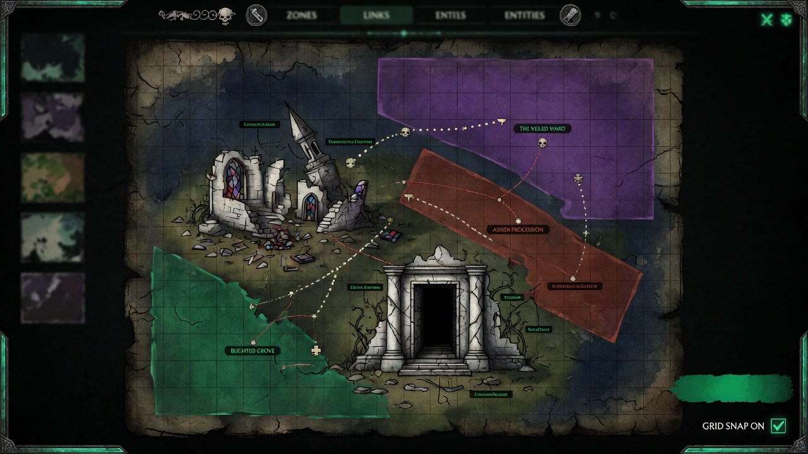

<p align="center">
  <a href="README.zh.md">中文</a> | <a href="README.es.md">Español</a> | <a href="README.fr.md">Français</a> | <a href="README.md">English</a> | <a href="README.it.md">Italiano</a> | <a href="README.pt-BR.md">Português (BR)</a>
</p>

<p align="center">
  
</p>

<p align="center">
  
</p>

<p align="center">
  <a href="https://github.com/mcp-tool-shop-org/world-forge/actions/workflows/ci.yml"></a>
  <a href="https://www.npmjs.com/package/@world-forge/schema"></a>
  <a href="https://opensource.org/licenses/MIT"></a>
  <a href="https://mcp-tool-shop-org.github.io/world-forge/"></a>
</p>

<p align="center">2D / 2.5D world authoring studio with peer export lanes for <a href="https://github.com/mcp-tool-shop-org/ai-rpg-engine">AI RPG Engine</a>, <a href="https://www.unrealengine.com/">Unreal Engine 5</a>, and <a href="https://godotengine.org/">Godot 4</a>.<br>One editor, many modes — paint zones, place entities, define districts, export a complete content pack for your engine of choice.</p>

<!-- version:start -->
<p align="center"><strong>v4.9.1</strong> — 3475 tests, 6 shipping packages, 7 authoring modes, tiles + interiors + town authoring + world modeling (vertical strata, typed hazards, party-gated zones), three export targets (AI RPG Engine, Unreal Engine 5, Godot 4), a measured Forge→Engine content contract, and an authored drawing contract for 2.5D clients</p>
<!-- version:end -->

## आर्किटेक्चर

```
packages/
  schema/          @world-forge/schema         — spatial types, validation, 2.5D fields
  export-ai-rpg/   @world-forge/export-ai-rpg  — AI RPG Engine export pipeline + CLI
  export-unreal/   @world-forge/export-unreal  — Unreal Engine 5 export pipeline + CLI (2.5D aware)
  export-godot/    @world-forge/export-godot   — Godot 4 export pipeline + .tscn scene generation
  renderer-2d/     @world-forge/renderer-2d    — PixiJS 2D canvas renderer
  editor/          @world-forge/editor         — React web authoring app
```

## त्वरित शुरुआत

```bash
npm install
npm run build
npm run dev --workspace=packages/editor
```

संपादक को लॉन्च करने के लिए `http://localhost:5173` खोलें।

### संपादक वर्कफ़्लो

1. **एक मोड चुनें** - कालकोठरी, जिला, दुनिया, महासागर, अंतरिक्ष, आंतरिक भाग, या जंगल - ग्रिड डिफ़ॉल्ट और कनेक्शन शब्दावली सेट करने के लिए।
2. **एक किट से शुरू करें** - टेम्पलेट प्रबंधक से एक स्टार्टर किट या शैली टेम्पलेट चुनें, या खाली से शुरू करें।
3. **ज़ोन पेंट करें** - ज़ोन बनाने, उन्हें जोड़ने और जिलों को असाइन करने के लिए कैनवस पर खींचें।
4. **इकाइयाँ रखें** - एनपीसी, दुश्मन, व्यापारी, मुठभेड़ और वस्तुओं को ज़ोन पर रखें।
5. **समीक्षा करें** - स्वास्थ्य स्थिति, सामग्री अवलोकन और सारांश निर्यात (मार्कडाउन/JSON) के लिए समीक्षा टैब खोलें।
6. **निर्यात करें** - प्रति-लक्ष्य तत्परता (✓ तैयार / ⚠ सलाह) देखने के लिए निर्यात मोडल खोलें, लक्ष्य विकल्पों को कॉन्फ़िगर करें, फिर AI RPG इंजन, UE5, या गॉडोट 4 पैक डाउनलोड करें। निर्यात के बाद रसीदें आकार, गणना और निष्ठा विवरण के साथ जुड़ जाती हैं। साथ ही: प्रोजेक्ट बंडल (.wfproject.json) और समीक्षा सारांश।

### सीएलआई निर्यात

```bash
# AI RPG Engine
npx world-forge-export project.json --out ./my-pack
npx world-forge-export project.json --validate-only
npx world-forge-export --import ./my-pack --out ./round-trip

# Unreal Engine 5
npx world-forge-export-unreal project.json --out ./UnrealPack --sign
npx world-forge-export-unreal --summary ./UnrealPack

# Godot 4 — writes a loadable project root (project.godot + world.tscn)
npx world-forge-export-godot project.json --out ./GodotPack
npx world-forge-export-godot project.json --validate-only
```

## पैकेज

### @world-forge/schema

दुनिया के निर्माण के लिए मुख्य TypeScript प्रकार और सत्यापन।

- **स्थानिक प्रकार** - `WorldMap`, `Zone`, `ZoneConnection`, `District`, `Landmark`, `SpawnPoint`, `EncounterAnchor`, `FactionPresence`, `PressureHotspot`
- **सामग्री प्रकार** - `EntityPlacement`, `ItemPlacement`, `DialogueDefinition`, `PlayerTemplate`, `BuildCatalogDefinition`, `ProgressionTreeDefinition`
- **दृश्य परतें** - `AssetEntry`, `AssetPack`, `Tileset`, `TileLayer`, `PropDefinition`, `PropPlacement`, `AmbientLayer`
- **शहर + संरचनाएं** - `MarketNode`, `CraftingStation`, `Building`, `Hub`, `Stronghold`
- **दुनिया का मॉडलिंग** - `Stratum` + `StratumLink` (ऊर्ध्वाधर परतें), `HazardDefinition` (टाइप किए गए प्रभाव संघ), `ZoneEntryGate` + पार्टी-स्टेट `SpawnCondition` ऑपरेंड (`party-level`, `party-size`, `item`, `flag`, `member`, `class`)
- **मोड सिस्टम** - `AuthoringMode` (7 मोड), मोड-विशिष्ट ग्रिड/कनेक्शन/सत्यापन प्रोफाइल
- **प्रस्तुति** - `WorldProject` पर वैकल्पिक `WorldPresentation`: डाइमेट्रिक दृश्य, टाइल पदचिह्न, ज़ोन एंकर सेल, फर्श प्लेटें और प्रति अभिनेता एक अधिभोग पंक्ति। `presentationAdvisories()` इस पर आठ सलाहकार नियम चलाता है, जिसमें वह भी शामिल है जो मायने रखता है - एक कमरे में खींचा गया व्यक्ति सिमुलेशन उन्हें कमरे के बाहर रखता है।
- **सत्यापन** - `validateProject()` (मानचित्र-आधारित O(n) लुकअप के साथ 89 संरचनात्मक जांच, `warningCount`), `advisoryValidation()` (मोड-विशिष्ट सुझाव, मेटाडेटा पूर्णता, संपत्ति नामकरण)। बाद में आवश्यक सरणियों को छोड़ने वाला v4.0 JSON, `normalizeProjectShape()` / `stampProjectSchemaVersion()` के बाद स्वीकार किया जाता है।
- **बैरल पर बंद संघ** - `VALID_CONNECTION_KINDS`, `VALID_ASSET_KINDS`, `VALID_ENTITY_ROLES`, `VALID_ITEM_SLOTS`, और शेष `VALID_*` सेट `@world-forge/schema` से निर्यात किए जाते हैं।
- **उपयोगिताएँ** - `assembleSceneData()` (लापता-संपत्ति पहचान के साथ दृश्य बंधन), `scanDependencies()` (संदर्भ ग्राफ विश्लेषण), `buildReviewSnapshot()` (स्वास्थ्य वर्गीकरण)

### @world-forge/export-unreal

एक `WorldProject` को 2.5D गेम के लिए अनुकूलित अनरियल इंजन 5 सामग्री पैक में परिवर्तित करता है।

- **आउटपुट** - `pack.json`, प्रति-ज़ोन और प्रति-जिला प्राथमिक डेटा एसेट JSON, समूहीकृत अभिनेता स्पॉन मेनिफेस्ट, प्रति कनेक्शन स्तर-स्ट्रीमिंग संकेत, वर्ल्ड पार्टीशन सेल संकेत और एक संरचित निष्ठा रिपोर्ट।
- **2.5D फ़ील्ड** - `Zone.elevation`, `elevationRange`, `parallaxLayers`, `skylineRef` को संरक्षित किया जाता है और UE सेमी / Z-अप निर्देशांक में परिवर्तित किया जाता है।
- **निर्देशांक परिवर्तन** - शुद्ध कार्य (`pixelsToUnrealCm`, `elevationToZ`, `worldForgeToUnrealAxis`, `gridToUnrealAxis`)। डिफ़ॉल्ट दुनिया का पैमाना 1 टाइल = 100 सेमी है।
- **राउंड-ट्रिप आयात** - `importFromUnreal` अनरियल पैक से WorldProject का पुनर्निर्माण करता है; गेमप्ले-केवल डेटा (संवाद, प्रगति, निर्माण) को निष्ठा रिपोर्ट में छोड़े गए के रूप में चिह्नित किया जाता है।
- **सीएलआई** - `world-forge-export-unreal` के साथ `--out`, `--tile-size-cm`, `--validate-only`, `--verbose`।

### @world-forge/export-godot

एक `WorldProject` को `.tscn` दृश्य पाठ के साथ गॉडोट 4 सामग्री पैक में परिवर्तित करता है।

- **आउटपुट** - एक गॉडोट 4 प्रोजेक्ट रूट: `project.godot`, `world.tscn` (ExtResource `.tres`), `assets/`, `scripts/player.gd` के तहत कॉपी की गई बनावट, साथ ही `pack.json` और `fidelity.json`
- **सीएलआई** - `world-forge-export-godot` के साथ `--out`, `--validate-only`, `--include-world-tscn` / `--no-world-tscn`
- **प्ले करने योग्य दृश्य** - `buildWorldScene()` एक नेविगेट करने योग्य `.tscn` उत्सर्जित करता है: प्रति-ज़ोन `StaticBody2D` टकराव + `NavigationRegion2D`, एक फ़्रेमयुक्त `Camera2D`, एक `CharacterBody2D` खिलाड़ी पॉन और y-सॉर्ट / `z_index` गहराई
- **टाइलें + आंतरिक भाग** - `TileMapLayer` + `TileSet` (बेक्ड `tile_map_data` छवि टाइलसेट के लिए), प्रति-सेल दीवार `StaticBody2D` टकराव और प्रॉप `Node2D` प्लेसमेंट
- **शहर** - बाजार + क्राफ्टिंग स्टेशन और इमारतें (`StaticBody2D` पदचिह्न) / हब / गढ़ के रूप में `Node2D` प्लेसहोल्डर, सभी अपने डेटा को मेटाडेटा के रूप में ले जाते हैं
- **दुनिया का मॉडलिंग** - ऊर्ध्वाधर स्तरीकरण (प्रति-ज़ोन `z_index` बैंडिंग + `StratumLink` कनेक्टर), टाइप किए गए खतरे `Area2D` क्षेत्रों के रूप में और ज़ोन प्रविष्टि-गेट मेटाडेटा के रूप में
- **निष्ठा रिपोर्टिंग** - हानि रहित, अनुमानित और छोड़े गए डेटा की संरचित ट्रैकिंग, वास्तविक गॉडोट 4 इंजन (हेडलेस स्मोक, 36 दावे) के विरुद्ध सत्यापित।
- **प्रस्तुति सलाह** - एक निर्मित `presentation` ब्लॉक को अपरिवर्तित रूप से ले जाया जाता है और इसकी सलाह `warnings[]` पर सवारी करती है, इसलिए एक ड्राइंग/सिमुलेशन असहमति स्क्रीन पर आश्चर्य के बजाय एक निर्यात निष्कर्ष है।
- **प्रारूप संस्करण** - `GODOT_PACK_FORMAT_VERSION` 1.1.0 (`files`, `zoneGates`, `migrateGodotPack`)

### @world-forge/export-ai-rpg

एक `WorldProject` को ai-rpg-engine के `ContentPack` प्रारूप में परिवर्तित करता है।

- **निर्यात** - ज़ोन, जिले, इकाइयाँ, आइटम, संवाद, खिलाड़ी टेम्पलेट, निर्माण सूची, प्रगति वृक्ष, मुठभेड़, गुट, हॉटस्पॉट, मेनिफेस्ट और पैक मेटाडेटा
- **आयात** - 8 रिवर्स कन्वर्टर निर्यात किए गए JSON से WorldProject का पुनर्निर्माण करते हैं; सीएलआई `--import` / `--from-pack` `world-project.json` (या stdout) लिखता है
- **निष्ठा रिपोर्टिंग** - रूपांतरण के दौरान क्या हानि रहित, अनुमानित या छोड़ा गया था, इसकी संरचित ट्रैकिंग; `--out` पैक के बगल में `fidelity.json` लिखता है
- **प्रारूप पहचान** - WorldProject, ExportResult, ContentPack और ProjectBundle प्रारूपों का स्वतः पता लगाता है
- **सीएलआई** - `world-forge-export` के साथ `--out`, `--import`, `--from-pack`, `--validate-only`, `--dry-run` और `--verbose`

### @world-forge/renderer-2d

PixiJS-आधारित 2D रेंडरर: पैन/ज़ूम, ज़ोन ओवरले के साथ जिला रंग, कनेक्शन तीर, भूमिका के अनुसार इकाई आइकन, टाइल परतें और एक मिनीमैप के साथ दृश्य।

एक स्टैंडअलोन रेंडरर जो बाहरी उपभोक्ताओं के लिए प्रकाशित किया गया है, जो वर्ल्ड फोर्ज डेटा को अपने स्वयं के PixiJS ऐप में एम्बेड करते हैं। **संपादक इसका उपयोग नहीं करता है** - संपादक का कैनवस एक सीधा Canvas2D कार्यान्वयन है, इसलिए नीचे संपादक के तहत सूचीबद्ध मिनीमैप और दृश्य सुविधाएँ इसकी अपनी हैं, न कि इस पैकेज की।

### @world-forge/editor

ज़ुस्टैंड राज्य प्रबंधन, क्रिया लेबल के साथ पूर्ववत/फिर से करें, ऑटो-सहेजें (30 सेकंड थ्रॉटल, 3-संस्करण इतिहास, क्रैश रिकवरी), सभी प्रोजेक्ट-लोडिंग पथों पर गंदे-राज्य गार्ड, डार्क/लाइट थीम टॉगल, मोडल फोकस ट्रैप और कीबोर्ड-संचालित टूल स्विचिंग के साथ रिएक्ट 19 + वाइट वेब ऐप।

#### कार्यक्षेत्र टैब

| टैब | उद्देश्य |
|-----|---------|
| मानचित्र | 2डी कैनवस पर ज़ोन/इकाई/ज़िले का संपादन |
| वस्तुएँ | पदानुक्रमित वृक्ष: ज़िले → ज़ोन → इकाइयाँ/लैंडमार्क/स्पॉन |
| खिलाड़ी | आंकड़ों, इन्वेंट्री, उपकरण और स्पॉन के साथ खिलाड़ी टेम्पलेट |
| बिल्ड | आर्केटाइप, पृष्ठभूमि, विशेषताएँ, अनुशासन, संयोजन |
| वृक्ष | आवश्यकताओं और प्रभावों के साथ प्रगति नोड |
| संवाद | नोड संपादन, विकल्प लिंकिंग, टूटे हुए संदर्भ का पता लगाना |
| प्रीसेट | मर्ज/ओवरराइट के साथ क्षेत्र और मुठभेड़ प्रीसेट ब्राउज़र |
| संपत्तियाँ | संपत्ति पुस्तकालय जिसमें प्रकार-आधारित खोज, अनाथ वस्तुओं का पता लगाना और संपत्ति पैक शामिल हैं |
| मुद्दे | लाइव समूहीकृत सत्यापन जिसमें क्लिक-टू-फ़ोकस नेविगेशन शामिल है |
| निर्भरताएँ | इनलाइन मरम्मत बटन के साथ निर्भरता स्कैनर |
| समीक्षा | स्वास्थ्य डैशबोर्ड, सामग्री अवलोकन, सारांश निर्यात |
| मार्गदर्शन | हॉटकी संदर्भ के साथ पहली बार उपयोग करने के लिए चेकलिस्ट |

#### कैनवस और संपादन

- **उपकरण** — चयन करें, ज़ोन-पेंट, कनेक्शन, इकाई-प्लेस, लैंडमार्क, स्पॉन, आइटम-प्लेस, मुठभेड़-प्लेस
- **मल्टी-सेलेक्ट** — शिफ्ट-क्लिक, बॉक्स-सेलेक्ट, Ctrl+A; परमाणु पूर्ववत के साथ ड्रैग-मूव
- **संरेखण** — 6-तरफ़ा संरेखण (बाएं/दाएं/ऊपर/नीचे/केंद्र-क्षैतिज/केंद्र-ऊर्ध्वाधर) और क्षैतिज/ऊर्ध्वाधर वितरण
- **स्नैपिंग** — दृश्य मार्गदर्शिका रेखाओं के साथ आस-पास की वस्तुओं के किनारों/केंद्रों पर ड्रैग-टाइम स्नैप
- **आकार बदलें** — प्रत्येक ज़ोन के लिए 8 हैंडल, किनारे स्नैपिंग, न्यूनतम-आकार क्लैम्पिंग, लाइव पूर्वावलोकन
- **डुप्लिकेट** — पुन: मैप किए गए आईडी, कनेक्शन और ज़िला असाइनमेंट के साथ Ctrl+D
- **कॉपी/पेस्ट** — आईडी रीमैपिंग और कॉन्फ़िगर करने योग्य ऑफ़सेट के साथ Ctrl+C / Ctrl+V
- **क्लिक-साइकिल** — एक ही स्थिति पर बार-बार क्लिक करने से अतिव्यापी वस्तुओं के माध्यम से चक्र चलता है
- **संदर्भ मेनू** — 7 संदर्भ-संवेदनशील क्रियाओं के लिए राइट-क्लिक (गुण, हटाएं, डुप्लिकेट, आदि)
- **कनेक्शन पूर्वावलोकन** — कनेक्शन उपकरण प्लेसमेंट के दौरान धराशायी सियान रेखा
- **मिनिमैप** — 200×150 अवलोकन (नीचे-दाएं), क्लिक करके जाएं
- **व्यूपोर्ट कल्लिंग** — केवल दृश्यमान सीमाओं के भीतर की वस्तुओं को प्रस्तुत करता है (64px मार्जिन)
- **प्रदर्शन आँकड़े** — FPS/वस्तु गणना/रेंडर समय ओवरले को टॉगल करें
- **प्रति-वस्तु दृश्यता** — व्यक्तिगत वस्तुओं को छिपाएं/दिखाएं (localStorage में संग्रहीत)
- **परतें** — दृश्यता टॉगल (ग्रिड, कनेक्शन, इकाइयाँ, लैंडमार्क, स्पॉन, शहर, टाइलें, प्रॉप्स, परिवेश; आइटम आइटम परत के साथ हिट-टेस्ट करते हैं)

#### नेविगेशन और शॉर्टकट

- **व्यूपोर्ट** — पैन/ज़ूम कैमरा, माउसव्हील ज़ूम (कर्सर-एंकर), स्पेसबार/मध्य-माउस/दाएं-क्लिक ड्रैग-पैन, स्वचालित रूप से सामग्री में फिट, केंद्र में लाने के लिए डबल-क्लिक करें
- **खोज** — Ctrl+K ओवरले खोलता है ताकि नाम/आईडी द्वारा किसी भी वस्तु को खोजने के लिए अस्पष्ट मिलान, कीबोर्ड नेविगेशन और हालिया खोज इतिहास (localStorage) का उपयोग किया जा सके
- **स्पीड पैनल** — संदर्भ-जागरूक क्रियाओं, पिन करने योग्य पसंदीदा, मैक्रोज़ और मोड-सुझाई गई त्वरित क्रियाओं के साथ फ़्लोटिंग कमांड पैलेट के लिए डबल-राइट-क्लिक करें
- **हॉटकी** — 21 कीबोर्ड शॉर्टकट जिसमें उपकरण स्विचिंग (V/Z/C/E/L/S), विवरण खोलें (Enter), प्रीसेट लागू करें (P), प्रीसेट सहेजें (Shift+P), कॉपी/पेस्ट (Ctrl+C/V), तीर नज़ (Shift = 5×) शामिल हैं
- **पहुंच** — एस्केप-टू-क्लोज़ के साथ मोडल फोकस ट्रैप, सभी आइकन-केवल बटन पर एआरआईए लेबल, कीबोर्ड-नेविगेट करने योग्य वस्तु वृक्ष, स्क्रीन-रीडर-घोषित गंदा संकेतक। स्थानिक कैनवस संचालन (प्लेसमेंट, बॉक्स-सेलेक्ट, आकार बदलें, कनेक्शन ड्राइंग, पैनिंग) पॉइंटर-आधारित रहते हैं

#### आयात और निर्यात

- **ContentPack** — प्रति-लक्ष्य तत्परता बैज, कॉन्फ़िगर करने योग्य विकल्प (टाइल आकार, दृश्य उपसर्ग, बंडल फ़िल्टरिंग) और पोस्ट-डाउनलोड रसीद के साथ एआई आरपीजी इंजन, अनरियल इंजन 5 या गॉडोट 4 में लक्ष्य-जागरूक निर्यात
- **परियोजना बंडल** — पोर्टेबल `.wfproject.json` फ़ाइलें जिसमें उत्पत्ति मेटाडेटा और निर्भरता जानकारी होती है
- **किट बंडल** — `.wfkit.json` निर्यात/आयात जिसमें सत्यापन, टकराव प्रबंधन और उत्पत्ति ट्रैकिंग शामिल है
- **आयात** — संरचित निष्ठा रिपोर्ट के साथ 4 प्रारूपों का स्वचालित रूप से पता लगाता है
- **अंतर** — आयात के बाद से सिमेंटिक परिवर्तन ट्रैकिंग
- **दृश्य पूर्वावलोकन** — सभी ज़ोन दृश्य बाध्यकारी का इनलाइन HTML/CSS रचना

## लेखन मोड

वर्ल्ड फ़ॉर्ज **शैली** (कल्पना, साइबरपंक, समुद्री डाकू) को **मोड** (कालकोठरी, महासागर, अंतरिक्ष) से अलग करता है। शैली स्वाद है — मोड पैमाना है। मोड ग्रिड डिफ़ॉल्ट, कनेक्शन शब्दावली, सत्यापन सुझाव, मार्गदर्शिका शब्दांकन और प्रीसेट फ़िल्टरिंग को नियंत्रित करता है।

| मोड | ग्रिड | टाइल | मुख्य कनेक्शन |
|------|------|------|-----------------|
| कालकोठरी | 30×25 | 32 | दरवाजा, सीढ़ी, मार्ग, गुप्त, खतरा |
| ज़िला / शहर | 50×40 | 32 | सड़क, दरवाजा, मार्ग, पोर्टल |
| क्षेत्र / दुनिया | 80×60 | 48 | सड़क, पोर्टल, मार्ग |
| महासागर / समुद्र | 60×50 | 48 | चैनल, मार्ग, पोर्टल, खतरा |
| अंतरिक्ष | 100×80 | 64 | डॉकिंग, वार्प, मार्ग, पोर्टल |
| आंतरिक | 20×15 | 24 | दरवाजा, सीढ़ी, मार्ग, गुप्त |
| जंगली इलाका | 60×50 | 48 | पगडंडी, सड़क, मार्ग, खतरा |

मोड को परियोजना बनाते समय सेट किया जाता है और इसे `WorldProject` पर `mode?: AuthoringMode` के रूप में संग्रहीत किया जाता है। प्रत्येक मोड **स्मार्ट डिफ़ॉल्ट** प्रदान करता है — कनेक्शन प्रकार, इकाई भूमिकाएँ, ज़ोन नाम और स्पीड पैनल सुझाव स्वचालित रूप से अनुकूलित होते हैं।

## लेखन सतह

### विश्व संरचना

- स्थानिक लेआउट, पड़ोसी, निकास, प्रकाश, शोर, खतरे और इंटरैक्टेबल वस्तुओं वाले क्षेत्र
- 12 प्रकार के कनेक्शन (मार्ग, दरवाजा, सीढ़ी, सड़क, पोर्टल, गुप्त मार्ग, खतरा, चैनल, मार्ग, डॉकिंग, वार्प, निशान) जिनमें अलग-अलग दृश्य शैली, किनारे से जुड़े रूटिंग, दिशात्मक तीर, और सशर्त डैश वाली शैली हो
- गुट नियंत्रण, अर्थव्यवस्था प्रोफाइल, मेट्रिक्स स्लाइडर, टैग और क्षेत्र के केंद्र बिंदुओं पर क्षेत्र के नाम लेबल वाले जिले
- स्थलचिह्न (क्षेत्रों के भीतर रुचि के नामित बिंदु)
- स्पॉन पॉइंट, मुठभेड़ एंकर (प्रकार-आधारित रंग), गुट की उपस्थिति और दबाव वाले हॉटस्पॉट
- **ऊर्ध्वाधर परतें** - अलग-अलग परतें (सतह / भूमिगत / आकाश, या इमारत की मंजिलें) जिनमें क्रम, z-रेंज, इंटर-लेयर दृश्यता और कनेक्टर (सीढ़ी / सीढ़ी / लिफ्ट) हों; क्षेत्र को एक परत में असाइन किया जाता है
- **विशिष्ट पर्यावरणीय खतरे** - एक साझा खतरा लाइब्रेरी (क्षति / स्थिति / तत्काल मृत्यु / प्रज्वलन प्रभाव, ट्रिगर समय, भूभाग गति-लागत, पारगम्यता, दृष्टि-अवरोध, मौसम नियंत्रण) जो प्रत्येक क्षेत्र के लिए संदर्भित है
- **क्षेत्र प्रवेश पार्टी-गेट** - पार्टी की स्थिति (स्तर / आकार / वस्तुएं / ध्वज / सदस्य / वर्ग) के आधार पर गेट प्रवेश, एक कठोर या सलाहकार गेट के रूप में जिसमें "लॉक दिखाएं" का एक कारण हो
- **प्रस्तुति अधिभोग** - 2.5D क्लाइंट के लिए: एक डाइमेट्रिक दृश्य जिसमें टाइल फुटप्रिंट और स्पैन, एक एंकर सेल और प्रत्येक क्षेत्र के लिए वैकल्पिक फर्श प्लेट, और एक अधिभोग पंक्ति (चरित्र पैक, क्षेत्र, सेल, दिशा) हो, जिसमें खिलाड़ी भी शामिल है

### सामग्री

- आँकड़ों, संसाधनों, AI प्रोफाइल और कस्टम मेटाडेटा के साथ इकाई प्लेसमेंट
- स्लॉट, दुर्लभता, आँकड़ा संशोधक और प्रदान की गई क्रियाओं के साथ आइटम प्लेसमेंट
- शाखाओं वाली बातचीत, शर्तें और प्रभावों के साथ संवाद ट्री
- कैनवस पर मुठभेड़ एंकर - लाल हीरे के आकार के मार्कर जिनमें बॉस/घात/गश्ती प्रकार हों

### शहर और आंतरिक भाग

- टाइल पेंटिंग - छवि-आधारित टाइलसेट (पंक्ति/कॉलम द्वारा स्लाइस) जिसमें रंगीन-आयत फॉलबैक, एक ड्रैग ब्रश, परतें और प्रति-टाइल "ठोस" चलने की क्षमता हो, ताकि दीवार के टकराव को नियंत्रित किया जा सके
- आंतरिक भाग के लिए प्रॉप प्लेसमेंट (पैलेट + कैनवस रेंडर), जिसमें एक प्लेस टूल हो
- शहर की अर्थव्यवस्था - बाजार नोड (आपूर्ति श्रेणियां, मूल्य संशोधक, तस्करी) और क्राफ्टिंग स्टेशन (स्टेशन प्रकार, रेसिपी), जो प्रत्येक क्षेत्र के लिए संपादित किए जाते हैं
- शहर की संरचनाएं - इमारतें (आंतरिक-क्षेत्र लिंक के साथ प्रवेश योग्य फुटप्रिंट), हब (सेवा + कनेक्टिविटी नोड) और गढ़ (मजबूत गुट सीटें)

### चरित्र प्रणाली

- खिलाड़ी टेम्पलेट (प्रारंभिक आँकड़े, इन्वेंट्री, उपकरण, स्पॉन पॉइंट)
- बिल्ड कैटलॉग (आर्केटाइप, पृष्ठभूमि, लक्षण, अनुशासन, क्रॉस-शीर्षक, उलझनें)
- प्रगति ट्री (आवश्यकताओं और प्रभावों के साथ कौशल/क्षमता नोड)

### संपत्तियाँ

- संपत्ति सूची (पोर्ट्रेट, स्प्राइट, पृष्ठभूमि, आइकन, टाइलसेट) जिसमें प्रकार-विशिष्ट बंधन हों
- संपत्ति पैक (नाम, संस्करणित समूह जिनमें संगतता मेटाडेटा, थीम, लाइसेंस हो)
- दृश्य पूर्वावलोकन (सभी क्षेत्र दृश्य बंधनों की इनलाइन रचना जिसमें गुम संपत्ति का पता लगाया जा सके)

### कार्यप्रवाह

- क्षेत्र प्रीसेट (9 अंतर्निहित, मोड-फ़िल्टर्ड) और मुठभेड़ प्रीसेट (10 अंतर्निहित) जिनमें मर्ज/ओवरराइट एप्लिकेशन और कस्टम प्रीसेट CRUD हो
- स्टार्टर किट (7 अंतर्निहित, मोड-विशिष्ट) जिनमें किट निर्यात/आयात (`.wfkit.json`), टकराव प्रबंधन और उत्पत्ति ट्रैकिंग हो
- लेआउट टेम्पलेट (6 पूर्व-निर्मित क्षेत्र व्यवस्था) और संवाद टेम्पलेट (5 वार्तालाप स्टार्टर)
- क्षेत्र मर्ज और बैच इकाई प्लेसमेंट (ग्रिड/यादृच्छिक/वृत्त पैटर्न)
- 30-सेकंड थ्रॉटल और 3-संस्करण रिकवरी इतिहास के साथ ऑटो-सेव
- सभी ऑब्जेक्ट प्रकारों में अस्पष्ट मिलान और हाल के इतिहास के साथ Ctrl+K खोज
- स्पीड पैनल कमांड पैलेट जिसमें पिन करने योग्य पसंदीदा, मैक्रो, कस्टम समूह और मोड सुझाव हों
- 21 केंद्रीकृत कीबोर्ड शॉर्टकट (जिसमें 6 टूल-स्विचिंग कुंजियाँ शामिल हैं)
- परियोजना मेटाडेटा संपादक (लेखक, लाइसेंस, श्रेणी, टैग)
- समीक्षा आँकड़े (भूमिका वितरण, कनेक्शन प्रकार, मुठभेड़ प्रकार, प्रति क्षेत्र क्षेत्र)
- ContentPack JSON, परियोजना बंडल और समीक्षा सारांश में निर्यात
- संरचित निष्ठा रिपोर्टिंग, मरम्मत सुझाव और सिमेंटिक अंतर ट्रैकिंग के साथ 4 प्रारूपों से आयात

वर्तमान सतह को साबित करने के लिए चैपल थ्रेसहोल्ड निर्यात हैंडशेक के लिए [`dogfood/WALKTHROUGH.md`](dogfood/WALKTHROUGH.md) देखें।

## डॉगफूड निर्देशिका

`dogfood/` निर्देशिका में एक एकीकरण परीक्षण हार्नेस है जो इकाई परीक्षणों के बाहर पूर्ण लेखक-से-निर्यात पाइपलाइन का अभ्यास करता है। चैपल थ्रेसहोल्ड उदाहरण (`chapel-threshold.ts`) एक छोटा लेकिन पूर्ण विश्व परियोजना बनाता है, इसे निर्यात के माध्यम से चलाता है, और आउटपुट को `dogfood/output/` में लिखता है। यह साबित करता है कि स्कीमा प्रकार, सत्यापन और निर्यात पाइपलाइन वास्तविक डेटा के साथ अंत-से-अंत तक काम करते हैं - न कि केवल अलग-अलग मॉक के साथ।

## इंजन संगतता

निर्यात तीन इंजनों को लक्षित करते हैं:

- **[ai-rpg-engine](https://github.com/mcp-tool-shop-org/ai-rpg-engine)** - ContentPack प्रारूप: नियतात्मक सिमुलेशन रनटाइम जो एक निर्यातित पैक लोड करता है और दुनिया को चलाता है
- **अनरियल इंजन 5** - 2.5D-जागरूक सामग्री पैक जिसमें प्राइमरी डेटा एसेट्स, अभिनेता स्पॉन मेनिफेस्ट और वर्ल्ड पार्टिशन संकेत हों
- **गॉडोट 4** - `.tscn` दृश्य पीढ़ी जिसमें क्षेत्र संसाधन, नेविगेशन लिंक और इकाई मेनिफेस्ट हों

### फोर्ज→इंजन सामग्री अनुबंध

एक एक्सपोर्टर जो चलता है, वह उस दुनिया के समान नहीं है जो बूट होती है। v4.6.0 AI RPG इंजन लेन के लिए उस अंतर को बंद करता है, और - अधिक उपयोगी रूप से - शेष अंतर को एक धारणा के बजाय एक संख्या बनाता है।

- **एक मापा हुआ निर्यात तालिका** (`docs/c0-alignment/`) — एक लीफ-पाथ डिफर हर निर्मित फ़ील्ड पर चलता है और रिकॉर्ड करता है कि कौन से फ़ील्ड वास्तव में रनटाइम तक पहुंचते हैं। इसे हर परीक्षण रन पर उत्पन्न, जांचा और सत्यापित किया जाता है, इसलिए "निर्यात में क्या बचता है" यह सत्यापित किया जा सकता है, न कि केवल दावा किया जा सकता है।
- **एक ईमानदार मेनिफेस्ट** — उत्सर्जित पैक में एक वास्तविक इंजन सेमवर रेंज, वास्तविक मॉड्यूल आईडी, एक सामग्री हैश और संकलित निकास स्थितियां होती हैं। मॉड्यूल आईडी वास्तविक सामग्री पर आधारित होते हैं: एक ऐसे पैक में जिसमें कोई क्राफ्टिंग स्टेशन नहीं है, अब क्राफ्टिंग मॉड्यूल का दावा नहीं किया जाएगा।
- **स्थान शब्दावली का मिलन** — प्रति-इकाई प्लेसमेंट, जिसमें संकलित स्पॉन स्थितियां, टाइप किए गए खतरे, प्रवेश द्वार और दृश्य विवरण शामिल हैं, इंजन के सामग्री पैक तक पहुंचते हैं, न कि केवल स्कीमा तक।
- **विश्वसनीयता रिपोर्ट अनुबंध का पालन करती है।** प्रत्येक लेन रिपोर्ट करता है कि क्या डेटा बिना किसी नुकसान के, अनुमानित रूप से या हटाकर संसाधित किया गया। जहां कोई फ़ील्ड स्थानांतरित नहीं हो सकता है, निर्यात यह बताता है — यह चुपचाप सफल नहीं होता है।

इसके लिए `ai-rpg-engine` `^3.8.0` की आवश्यकता है।

### ड्राइंग अनुबंध

एक दुनिया यह भी बता सकती है कि क्लाइंट को इसे कैसे **ड्रॉ** करना चाहिए। `WorldProject.presentation` वैकल्पिक और अतिरिक्त है — अधिकांश दुनिया में यह नहीं होता है और इसके लिए उन्हें दंडित नहीं किया जाता है — और इसमें डाइमेट्रिक दृश्य, टाइल पदचिह्न, प्रति क्षेत्र एक ज़ोन एंकर सेल और फर्श प्लेट, और प्रति अभिनेता एक अधिभोग पंक्ति शामिल है।

यह इसलिए मौजूद है क्योंकि 2.5डी दुनिया को एक साथ तीन ग्रिड द्वारा वर्णित किया जाता है, और निर्यात उनमें से किसी के बीच भी परिवर्तित नहीं होता है:

| ग्रिड | इकाई | मालिक | हैश किया गया |
|---|---|---|---|
| सिम अधिभोग | ज़ोन आईडी | इंजन का `WorldState` | हाँ — आधिकारिक |
| डाइमेट्रिक सेल | 256x128 हीरा, अवधि 3 | क्लाइंट का दृश्य, `presentation` के माध्यम से | कभी नहीं |
| फोर्ज कार्टेशियन | `gridX` / `gridY` | संपादक और गॉडोट `.tscn` | कभी नहीं |

एक डाइमेट्रिक सेल कभी भी `gridX`/`gridY` से प्राप्त नहीं होता है, और सैंडबॉक्स स्केल नाम से ब्लॉक को छोड़ देता है ताकि एक पूर्ण हीरा सेल को गलती से गुणा नहीं किया जा सके। सिम हमेशा इस बारे में विवाद जीत जाता है कि कोई व्यक्ति किस कमरे में है; `presentationAdvisories()` इसे ज़ोर से कहता है, `exportToGodot` इसे `warnings[]` पर रिपोर्ट करता है, और स्टेज-फिक्स्चर लेन इसे `--strict` के साथ घातक बना सकता है।

ब्लॉक गॉडोट स्टेज फिक्स्चर के `pack.json` पर यात्रा करता है। यह `export-ai-rpg` लेन पर यात्रा नहीं करता है — इंजन के `ContentPack` में कोई अतिरिक्त स्लॉट नहीं है और इसका लोडर सख्त है — और मापा हुआ निर्यात तालिका इसे वहां हटाए गए के रूप में रिपोर्ट करता है, न कि इसके विपरीत।

## सुरक्षा

- **उपयोग किया गया डेटा:** स्थानीय डिस्क पर प्रोजेक्ट फ़ाइलें (उपयोगकर्ता द्वारा बनाई गई JSON), कोई सर्वर-साइड संग्रहण नहीं
- **उपयोग नहीं किया गया डेटा:** कोई टेलीमेट्री नहीं, कोई एनालिटिक्स नहीं, स्थानीय विकास सर्वर से परे कोई नेटवर्क अनुरोध नहीं
- **अनुमतियाँ:** कोई एपीआई कुंजी नहीं, कोई गुप्त जानकारी नहीं, कोई क्रेडेंशियल नहीं
- **स्रोत में कोई गुप्त जानकारी, टोकन या क्रेडेंशियल नहीं**

## लाइसेंस

एमआईटी

---

[एमसीपी टूल शॉप](https://mcp-tool-shop.github.io/) द्वारा निर्मित
