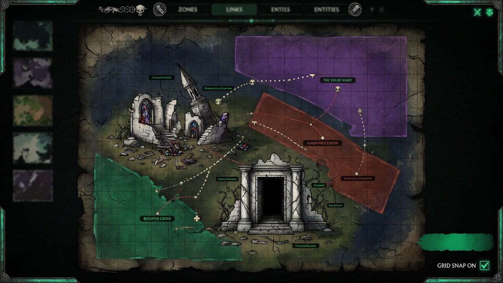

<p align="center">
  <a href="README.md">English</a> | <a href="README.zh.md">中文</a> | <a href="README.es.md">Español</a> | <a href="README.fr.md">Français</a> | <a href="README.hi.md">हिन्दी</a> | <a href="README.it.md">Italiano</a> | <a href="README.pt-BR.md">Português (BR)</a>
</p>

<p align="center">
  
</p>

<p align="center">
  
</p>

<p align="center">
  <a href="https://github.com/mcp-tool-shop-org/world-forge/actions/workflows/ci.yml"></a>
  <a href="https://www.npmjs.com/package/@world-forge/schema"></a>
  <a href="https://opensource.org/licenses/MIT"></a>
  <a href="https://mcp-tool-shop-org.github.io/world-forge/"></a>
</p>

<p align="center">2D / 2.5D world authoring studio with peer export lanes for <a href="https://github.com/mcp-tool-shop-org/ai-rpg-engine">AI RPG Engine</a>, <a href="https://www.unrealengine.com/">Unreal Engine 5</a>, and <a href="https://godotengine.org/">Godot 4</a>.<br>One editor, many modes — paint zones, place entities, define districts, export a complete content pack for your engine of choice.</p>

<!-- version:start -->
<p align="center"><strong>v4.9.1</strong> — 3475 tests, 6 shipping packages, 7 authoring modes, tiles + interiors + town authoring + world modeling (vertical strata, typed hazards, party-gated zones), three export targets (AI RPG Engine, Unreal Engine 5, Godot 4), a measured Forge→Engine content contract, and an authored drawing contract for 2.5D clients</p>
<!-- version:end -->

## アーキテクチャ

```
packages/
  schema/          @world-forge/schema         — spatial types, validation, 2.5D fields
  export-ai-rpg/   @world-forge/export-ai-rpg  — AI RPG Engine export pipeline + CLI
  export-unreal/   @world-forge/export-unreal  — Unreal Engine 5 export pipeline + CLI (2.5D aware)
  export-godot/    @world-forge/export-godot   — Godot 4 export pipeline + .tscn scene generation
  renderer-2d/     @world-forge/renderer-2d    — PixiJS 2D canvas renderer
  editor/          @world-forge/editor         — React web authoring app
```

## クイックスタート

```bash
npm install
npm run build
npm run dev --workspace=packages/editor
```

`http://localhost:5173`を開いてエディターを起動します。

### エディターのワークフロー

1. **モードを選択** — ダンジョン、地区、ワールド、海、宇宙、インテリア、または荒野 — グリッドのデフォルトと接続語彙を設定します。
2. **キットから開始** — テンプレートマネージャーからスターターキットまたはジャンルテンプレートを選択するか、空白から開始します。
3. **ゾーンをペイント** — キャンバス上でドラッグしてゾーンを作成し、接続し、地区を割り当てます。
4. **エンティティを配置** — NPC、敵、商人、遭遇、アイテムをゾーンにドロップします。
5. **確認** — ヘルスステータス、コンテンツの概要、および要約エクスポート（Markdown / JSON）については、レビュータブを開きます。
6. **エクスポート** — エクスポートモーダルを開いて、ターゲットごとの準備状況（✓準備完了/⚠注意）を確認し、ターゲットオプションを設定してから、AI RPG Engine、UE5、またはGodot 4パックをダウンロードします。エクスポート後のレシートには、サイズ、数、および忠実度に関する詳細が記載されます。また、プロジェクトバンドル（.wfproject.json）とレビューの概要も含まれます。

### CLIエクスポート

```bash
# AI RPG Engine
npx world-forge-export project.json --out ./my-pack
npx world-forge-export project.json --validate-only
npx world-forge-export --import ./my-pack --out ./round-trip

# Unreal Engine 5
npx world-forge-export-unreal project.json --out ./UnrealPack --sign
npx world-forge-export-unreal --summary ./UnrealPack

# Godot 4 — writes a loadable project root (project.godot + world.tscn)
npx world-forge-export-godot project.json --out ./GodotPack
npx world-forge-export-godot project.json --validate-only
```

## パッケージ

### @world-forge/schema

ワールド作成のためのコアTypeScriptタイプと検証。

- **空間タイプ** — `WorldMap`、`Zone`、`ZoneConnection`、`District`、`Landmark`、`SpawnPoint`、`EncounterAnchor`、`FactionPresence`、`PressureHotspot`
- **コンテンツタイプ** — `EntityPlacement`、`ItemPlacement`、`DialogueDefinition`、`PlayerTemplate`、`BuildCatalogDefinition`、`ProgressionTreeDefinition`
- **視覚レイヤー** — `AssetEntry`、`AssetPack`、`Tileset`、`TileLayer`、`PropDefinition`、`PropPlacement`、`AmbientLayer`
- **町と構造物** — `MarketNode`、`CraftingStation`、`Building`、`Hub`、`Stronghold`
- **ワールドモデリング** — `Stratum` + `StratumLink`（垂直レイヤー）、`HazardDefinition`（タイプ付きエフェクトのユニオン）、`ZoneEntryGate` + パーティの状態 `SpawnCondition`オペランド（`party-level`、`party-size`、`item`、`flag`、`member`、`class`）
- **モードシステム** — `AuthoringMode`（7つのモード）、モード固有のグリッド/接続/検証プロファイル
- **表現** — オプションの `WorldPresentation` を `WorldProject` に適用：等角投影、タイルのフットプリント、ゾーンアンカーセル、床のプレート、および各キャラクターごとの占有行。 `presentationAdvisories()` は、その中に重要なルール（シミュレーションで部屋内に配置された人物を部屋の外に配置する）を含む、8つの推奨ルールを適用します。
- **検証** — `validateProject()`（マップベースのO(n)検索による89の構造チェック、`warningCount`）、`advisoryValidation()`（モード固有の提案、メタデータの完全性、アセットの命名）。後で必要となる配列を省略した v4.0 JSONは、`normalizeProjectShape()` / `stampProjectSchemaVersion()` の後に受け入れられます。
- **バレル上のクローズドユニオン** — `VALID_CONNECTION_KINDS`、`VALID_ASSET_KINDS`、`VALID_ENTITY_ROLES`、`VALID_ITEM_SLOTS`、および残りの `VALID_*` セットは、`@world-forge/schema` からエクスポートされます。
- **ユーティリティ** — `assembleSceneData()`（欠落したアセットを検出する視覚的なバインディング）、`scanDependencies()`（参照グラフ分析）、`buildReviewSnapshot()`（健全性分類）

### @world-forge/export-unreal

`WorldProject`を、2.5Dゲーム用に調整されたUnreal Engine 5コンテンツパックに変換します。

- **出力** — `pack.json`、ゾーンごとおよび地区ごとのプライマリデータアセットJSON、グループ化されたアクター生成マニフェスト、接続ごとのレベルストリーミングヒント、ワールドパーティションセルヒント、および構造化された忠実度レポート。
- **2.5Dフィールド** — `Zone.elevation`、`elevationRange`、`parallaxLayers`、`skylineRef`は保持され、UE cm / Z-up座標に変換されます。
- **座標変換** — 純粋な関数（`pixelsToUnrealCm`、`elevationToZ`、`worldForgeToUnrealAxis`、`gridToUnrealAxis`）。デフォルトのワールドスケールは、1タイル= 100cmです。
- **ラウンドトリップインポート** — `importFromUnreal`は、UnrealパックからWorldProjectを再構築します。ゲームプレイ専用のデータ（対話、進行、ビルド）は、忠実度レポートでドロップされたものとしてフラグが立てられます。
- **CLI** — `world-forge-export-unreal`、`--out`、`--tile-size-cm`、`--validate-only`、`--verbose`を使用します。

### @world-forge/export-godot

`WorldProject`を、`.tscn`シーンテキストを含むGodot 4コンテンツパックに変換します。

- **出力** — Godot 4プロジェクトのルート：`project.godot`、`world.tscn`（ExtResource `.tres`）、コピーされたテクスチャは`assets/`、`scripts/player.gd`の下に配置され、さらに`pack.json`と`fidelity.json`も含まれます。
- **CLI** — `world-forge-export-godot`、`--out`、`--validate-only`、`--include-world-tscn` / `--no-world-tscn`を使用します。
- **再生可能なシーン** — `buildWorldScene()`は、ナビゲート可能な`.tscn`を生成します：ゾーンごとの`StaticBody2D`コリジョン+`NavigationRegion2D`、フレーム化された`Camera2D`、`CharacterBody2D`プレイヤーポーン、およびyソート/`z_index`深度。
- **タイル+インテリア** — `TileMapLayer` + `TileSet`（ベイクされた`tile_map_data`、イメージタイルセット用）、セルごとの壁`StaticBody2D`コリジョン、およびプロップ`Node2D`配置。
- **町** — 市場+クラフトステーション、および建物（`StaticBody2D`フットプリント）/ハブ/拠点は、メタデータとしてデータを保持した`Node2D`プレースホルダーとして機能します。
- **ワールドモデリング** — 垂直層（ゾーンごとの`z_index`バンド+`StratumLink`コネクタ）、型付きの危険要素を`Area2D`領域として、およびゾーンエントリーゲートメタデータ。
- **忠実度レポート** — 損失なし、近似、およびドロップされたデータを構造的に追跡し、実際のGodot 4エンジンに対して検証します（ヘッドレススモーク、36のアサーション）。
- **プレゼンテーションのアドバイス** — 作成された`presentation`ブロックは変更されずに保持され、そのアドバイスは`warnings[]`に適用されるため、描画/シミュレーションの不一致は、画面上で予期せぬものとして表示されるのではなく、エクスポート時の問題として認識されます。
- **フォーマットバージョン** — `GODOT_PACK_FORMAT_VERSION` 1.1.0（`files`、`zoneGates`、`migrateGodotPack`）。

### @world-forge/export-ai-rpg

`WorldProject`を、ai-rpg-engineの`ContentPack`形式に変換します。

- **エクスポート** — ゾーン、地区、エンティティ、アイテム、対話、プレイヤーテンプレート、ビルドカタログ、進行ツリー、遭遇、派閥、ホットスポット、マニフェスト、およびパックメタデータ。
- **インポート** — 8つの逆変換器は、エクスポートされたJSONからWorldProjectを再構築します。CLI `--import` / `--from-pack`は、`world-project.json`（または標準出力）に書き込みます。
- **忠実度レポート** — 変換中に損失なし、近似、またはドロップされたものを構造的に追跡します。`--out`は、パックの横に`fidelity.json`を書き込みます。
- **フォーマット検出** — WorldProject、ExportResult、ContentPack、およびProjectBundle形式を自動的に検出します。
- **CLI** — `world-forge-export`、`--out`、`--import`、`--from-pack`、`--validate-only`、`--dry-run`、および`--verbose`を使用します。

### @world-forge/renderer-2d

PixiJSベースの2Dレンダラー：パン/ズームを備えたビューポート、地区の色分けによるゾーンオーバーレイ、接続矢印、役割ごとのエンティティアイコン、タイルレイヤー、およびミニマップ。

スタンドアロンのレンダラーで、World Forgeデータを独自のPixiJSアプリに埋め込む外部のユーザー向けに公開されます。**エディターはこれを使用しません** — エディターのキャンバスは、直接的なCanvas2D実装であるため、以下にリストされているエディターのミニマップとビューポート機能は、このパッケージのものではなく、エディター独自のものです。

### @world-forge/editor

React 19 + Vite Webアプリで、Zustandステート管理、アクションラベルによるアンドゥ/リドゥ、自動保存（30秒のスロットリング、3バージョンの履歴、クラッシュからの復旧）、すべてのプロジェクトロードパスでのダーティステートガード、ダーク/ライトテーマの切り替え、モーダルフォーカストラップ、およびキーボード操作によるツール切り替えを備えています。

#### ワークスペースのタブ

| タブ | 目的 |
|-----|---------|
| マップ | 2Dキャンバス上でのゾーン/エンティティ/地区の編集 |
| オブジェクト | 階層構造：地区 → ゾーン → エンティティ/ランドマーク/スポーン地点 |
| プレイヤー | ステータス、インベントリ、装備、スポーン地点を含むプレイヤーテンプレート |
| ビルド | アーキタイプ、背景、特性、専門分野、コンボ |
| ツリー | 要件と効果を持つ進行ノード |
| ダイアログ | ノードの編集、選択肢のリンク、不正参照の検出 |
| プリセット | マージ/上書き機能付きのリージョンおよびエンカウンタープリセットブラウザ |
| アセット | 種類別にフィルタリングされた検索、孤立アセットの検出、アセットパックを備えたアセットライブラリ |
| 問題 | クリックしてフォーカスするナビゲーションによる、ライブグループ検証 |
| 依存関係 | インラインの修正ボタンを備えた依存関係スキャナー |
| レビュー | 健全性ダッシュボード、コンテンツ概要、要約エクスポート |
| ガイド | ホットキーリファレンスを含む、初回起動時のチェックリスト |

#### キャンバスと編集

- **ツール** — 選択、ゾーンペイント、接続、エンティティ配置、ランドマーク、スポーン、アイテム配置、エンカウンター配置
- **複数選択** — Shift+クリック、ボックス選択、Ctrl+A。アトミックなアンドゥ機能付きのドラッグ移動
- **配置** — 6方向配置（左/右/上/下/水平中央/垂直中央）および水平/垂直方向の配置
- **スナップ** — 視覚的なガイドラインを使用して、近くのオブジェクトのエッジ/中央にドラッグ中にスナップ
- **サイズ変更** — 各ゾーンに8つのハンドルがあり、エッジスナップ、最小サイズ制限、ライブプレビューが可能
- **複製** — Ctrl+Dで、ID、接続、地区の割り当てを再マッピング
- **コピー/ペースト** — Ctrl+C / Ctrl+Vで、IDを再マッピングし、構成可能なオフセットを設定
- **クリックサイクル** — 同じ位置を繰り返しクリックすると、重なり合ったオブジェクトが順番に表示される
- **コンテキストメニュー** — 右クリックすると、7つのコンテキストに依存したアクション（プロパティ、削除、複製など）が表示される
- **接続プレビュー** — 接続ツールの配置中に、破線のシアン色の線が表示される
- **ミニマップ** — 200×150の概要（右下）、クリックするとジャンプ
- **ビューポートカリング** — 画面に表示されている範囲内のオブジェクトのみをレンダリング（64ピクセルのマージン）
- **パフォーマンス統計** — FPS/オブジェクト数/レンダリング時間のオーバーレイを切り替える
- **オブジェクトごとの表示/非表示** — 個々のオブジェクトを表示/非表示（localStorageに保存）
- **レイヤー** — 表示/非表示の切り替え（グリッド、接続、エンティティ、ランドマーク、スポーン、町、タイル、プロップス、環境光。アイテムはアイテムレイヤーでヒットテストを行う）

#### ナビゲーションとショートカット

- **ビューポート** — カメラのパン/ズーム、マウスホイールによるズーム（カーソル固定）、スペースバー/中央のクリック/右クリックによるドラッグパン、コンテンツに自動的にフィット、ダブルクリックで中央に移動
- **検索** — Ctrl+Kを押すと、あいまい一致、キーボードナビゲーション、および最近の検索履歴（localStorage）を使用して、名前/IDで任意のオブジェクトを検索できるオーバーレイが開く
- **スピードパネル** — ダブル右クリックすると、コンテキストに応じたアクション、固定可能なFavorites、マクロ、およびモードに合わせたクイックアクションを備えたフローティングコマンドパレットが表示される
- **ホットキー** — 21個のキーボードショートカット（ツール切り替え（V/Z/C/E/L/S）、Enter（詳細を開く）、P（プリセットを適用）、Shift+P（プリセットを保存）、Ctrl+C/V（コピー/ペースト）、矢印キーによる微調整（Shift = 5倍））
- **アクセシビリティ** — Escapeキーで閉じることができるモーダルフォーカストラップ、すべてのアイコンのみのボタンにARIAラベルを適用、キーボードで操作可能なオブジェクトツリー、スクリーンリーダーで読み上げられる変更インジケーター。空間キャンバス操作（配置、ボックス選択、サイズ変更、接続描画、パン）は、ポインタベースのまま

#### インポートとエクスポート

- **ContentPack** — ターゲットに合わせたAI RPG Engine、Unreal Engine 5、またはGodot 4へのエクスポート。ターゲットごとの準備状況バッジ、構成可能なオプション（タイルサイズ、シーンのプレフィックス、バンドルフィルタリング）、およびダウンロード後のレシートを含む
- **プロジェクトバンドル** — プロベナンスメタデータと依存関係情報を含む、ポータブルな`.wfproject.json`ファイル
- **キットバンドル** — 検証、コリジョン処理、およびプロベナンス追跡を備えた`.wfkit.json`のエクスポート/インポート
- **インポート** — 構造化された忠実度レポートを使用して、4つの形式を自動的に検出
- **差分** — インポート以降のセマンティックな変更の追跡
- **シーンプレビュー** — すべてのゾーンの視覚的なバインディングのインラインHTML/CSSコンポジション

## オーサリングモード

World Forgeは、**ジャンル**（ファンタジー、サイバーパンク、海賊）と**モード**（ダンジョン、海洋、宇宙）を分離します。ジャンルは風味であり、モードは規模です。モードは、グリッドのデフォルト、接続の語彙、検証の提案、ガイドの文言、およびプリセットのフィルタリングを制御します。

| モード | グリッド | タイル | 主要な接続 |
|------|------|------|-----------------|
| ダンジョン | 30×25 | 32 | ドア、階段、通路、秘密の場所、危険 |
| 地区/都市 | 50×40 | 32 | 道路、ドア、通路、ポータル |
| リージョン/ワールド | 80×60 | 48 | 道路、ポータル、通路 |
| 海洋/海 | 60×50 | 48 | 水路、ルート、ポータル、危険 |
| 宇宙 | 100×80 | 64 | ドッキング、ワープ、通路、ポータル |
| インテリア | 20×15 | 24 | ドア、階段、通路、秘密の場所 |
| 荒野 | 60×50 | 48 | 小道、道路、通路、危険 |

モードは、プロジェクトの作成時に設定され、`WorldProject`に`mode?: AuthoringMode`として保存されます。各モードは**スマートなデフォルト**を提供します。接続の種類、エンティティの役割、ゾーンの名前、およびスピードパネルの提案は、自動的に調整されます。

## オーサリングサーフェス

### ワールド構造

- 空間的なレイアウト、隣接するエリア、出口、光、騒音、危険、インタラクション可能なオブジェクトを持つゾーン
- 12種類の接続タイプ（通路、ドア、階段、道、ポータル、秘密の通路、危険、チャネル、ルート、ドッキング、ワープ、トレイル）。それぞれ異なる視覚スタイル、エッジに固定されたルーティング、方向を示す矢印、条件付きの破線スタイルを持つ
- 勢力による支配、経済プロファイル、メトリクススライダー、タグ、ゾーンの中心に配置された地区名ラベルを持つ地区
- ランドマーク（ゾーン内の名前付きの興味深い場所）
- スポーンポイント、エンカウンターアンカー（タイプに基づく色の指定）、勢力の存在、危険なホットスポット
- **垂直層** - 離散的なレイヤー（表面/地下/空、または建物の階）。署名された順序、Z範囲、層間の視認性、コネクター（階段/はしご/エレベーター）を持つ。ゾーンは層に割り当てられる
- **タイプ指定された環境の危険** - 共有の危険ライブラリ（ダメージ/ステータス/即死/発火効果、トリガータイミング、地形の移動コスト、通過可能性、視界の遮断、天候の制御）。ゾーンごとに参照される
- **ゾーンエントリーパーティーゲート** - パーティーの状態（レベル/人数/アイテム/フラグ/メンバー/クラス）に基づいてゲートエントリーを制御する。ハードまたはアドバイザリーゲートとして機能し、「ロックを表示する」理由が設定されている
- **プレゼンテーションの占有** - 2.5Dクライアントの場合：タイルフットプリントとスパンを持つ等角投影ビュー、アンカーセル、オプションのフロアプレート（ゾーンごと）、およびアクター（プレイヤーを含む）ごとの占有行（キャラクターパック、ゾーン、セル、向き）

### コンテンツ

- ステータス、リソース、AIプロファイル、カスタムメタデータを持つエンティティの配置
- スロット、レア度、ステータス修正、付与されるアクションを持つアイテムの配置
- 分岐する会話、条件、効果を持つダイアログツリー
- キャンバス上のエンカウンターアンカー - ボス/待ち伏せ/パトロールタイプを示す赤いダイヤモンド型のマーカー

### 町と内部

- タイルペイント - 画像を背景にしたタイルセット（行/列でスライス）。色のついた長方形のフォールバック、ドラッグブラシ、レイヤー、および壁の衝突判定のためのタイルごとの「Solid」の歩行可能性を持つ
- インテリア用のプロップ配置（パレット+キャンバスレンダリング）、配置ツール付き
- 町の経済 - 市場ノード（供給カテゴリ、価格修正、違法品）、およびクラフトステーション（ステーションタイプ、レシピ）。ゾーンごとに編集可能
- 町の構造 - 建物（内部ゾーンへのリンクを持つ、内部を探索可能なフットプリント）、ハブ（サービス+接続ノード）、および要塞（要塞化された勢力の拠点）

### キャラクターシステム

- プレイヤーテンプレート（開始ステータス、インベントリ、装備、スポーンポイント）
- ビルドカタログ（アーキタイプ、背景、特性、専門分野、クロスタイトル、関係性）
- プログレッションツリー（要件と効果を持つスキル/アビリティノード）

### アセット

- アセットマニフェスト（ポートレート、スプライト、背景、アイコン、タイルセット）。種類ごとに特定のバインディングを持つ
- アセットパック（名前、バージョン、互換性メタデータ、テーマ、ライセンスを持つグループ化）
- シーンプレビュー（すべてのゾーンの視覚的なバインディングをインラインで構成。アセットの欠落を検出）

### ワークフロー

- リージョンプリセット（9種類、モードでフィルタリング）、エンカウンタープリセット（10種類）。マージ/上書きの適用、カスタムプリセットの作成/読み取り/更新/削除が可能
- スターターキット（7種類、モード固有）。キットのエクスポート/インポート（`.wfkit.json`）、衝突処理、および出所の追跡が可能
- レイアウトテンプレート（6種類の事前に構築されたゾーン配置）、ダイアログテンプレート（5種類の会話の開始）
- ゾーンのマージとバッチエンティティの配置（グリッド/ランダム/円形のパターン）
- 30秒間隔で自動保存、3バージョンの復元履歴
- Ctrl+Kで、あいまい一致と最近の履歴を使用して、すべてのオブジェクトタイプを検索
- ピン留め可能なFavorites、マクロ、カスタムグループ、およびモードの提案を備えた、Speed Panelコマンドパレット
- 21種類の集中型のキーボードショートカット（6つのツール切り替えキーを含む）
- プロジェクトメタデータエディター（作成者、ライセンス、カテゴリ、タグ）
- レビュー統計（役割の分布、接続タイプ、エンカウンタータイプ、地区ごとのゾーン数）
- ContentPack JSON、プロジェクトバンドル、およびレビューサマリーへのエクスポート
- 構造化された忠実度レポート、修正の提案、および意味的な差分追跡を備えた、4つの形式からのインポート

現在の表面を証明するChapel Thresholdのエクスポートハンドシェイクについては、[`dogfood/WALKTHROUGH.md`](dogfood/WALKTHROUGH.md)を参照してください。

## Dogfoodディレクトリ

`dogfood/`ディレクトリには、ユニットテスト外で、完全な作成からエクスポートまでのパイプラインをテストする統合テストハーネスが含まれています。Chapel Thresholdの例（`chapel-threshold.ts`）は、小さくても完全なワールドプロジェクトを構築し、エクスポートを実行し、出力を`dogfood/output/`に書き込みます。これにより、スキーマタイプ、検証、およびエクスポートパイプラインが、実際のデータでエンドツーエンドで機能することが証明されます。単なる孤立したモックではありません。

## エンジンとの互換性

エクスポートは、次の3つのエンジンを対象としています。

- **[ai-rpg-engine](https://github.com/mcp-tool-shop-org/ai-rpg-engine)** - ContentPack形式：エクスポートされたパックをロードし、ワールドを実行する決定論的なシミュレーションランタイム
- **Unreal Engine 5** - 2.5Dを意識したコンテンツパック。プライマリデータアセット、アクターのスポーンマニフェスト、およびWorld Partitionのヒントを含む
- **Godot 4** - ゾーンリソース、ナビゲーションリンク、およびエンティティマニフェストを持つ`.tscn`シーン生成

### Forge→Engineコンテンツ契約

実行されるエクスポーターは、起動するワールドと同じではありません。v4.6.0は、AI RPG Engineの分野でそのギャップを埋め、さらに重要なことに、残りのギャップを仮定ではなく数値にします。

- **計測されたエクスポートテーブル**（`docs/c0-alignment/`）—リーフパスの差分をたどり、作成されたすべてのフィールドを検証し、実際に実行時にどのフィールドが到達するかを記録します。これは、すべてのテスト実行で生成、チェックイン、および検証されるため、「エクスポートで残るもの」は、仮定ではなく、監査可能です。
- **信頼できるマニフェスト** — 出力されるパックには、実際のエンジンセマンティックバージョン範囲、実際のモジュールID、コンテンツハッシュ、およびコンパイルされた終了条件が含まれます。モジュールIDは、実際のコンテンツに基づいて制限されます。つまり、作成ステーションがないパックは、作成モジュールを主張しません。
- **空間語彙の交差** — コンパイルされたスポーン条件、型付きの危険性、エントリゲート、およびシーン記述子を持つ、エンティティごとの配置は、スキーマだけでなく、エンジンのコンテンツパックに到達します。
- **忠実度のレポートは契約を維持します**。各レーンは、損失がなかったもの、近似されたもの、または削除されたものを報告します。フィールドが交差できない場合、エクスポートはそのことを明示します。つまり、静かに成功することはありません。

`ai-rpg-engine` `^3.8.0`が必要です。

### 描画契約

ワールドは、クライアントがどのように描画すべきかを指定することもできます。`WorldProject.presentation`はオプションであり、追加機能です。ほとんどのワールドにはこれがないため、これがないことに対してペナルティは課せられません。これには、等角投影ビュー、タイルのフットプリント、ゾーンごとのアンカーセルとフロアプレート、およびアクターごとの1つの占有行が含まれます。

これは、2.5Dワールドが一度に3つのグリッドで記述され、エクスポートがそれらのグリッド間で変換しないために存在します。

| グリッド | ユニット | 所有者 | ハッシュ化 |
|---|---|---|---|
| シミュレーション占有 | ゾーンID | エンジンの`WorldState` | はい — 権威 |
| 等角セル | 256x128のダイヤモンド、スパン3 | クライアントのビュー、`presentation`経由 | 決して |
| フォージ・カルテシアン | `gridX` / `gridY` | エディターとGodotの`.tscn` | 決して |

等角セルは、`gridX`/`gridY`から派生することはありません。また、サンドボックススケールはブロックを名前でスキップするため、絶対的なダイヤモンドセルが誤って乗算されることはありません。シミュレーションは、常に人がどの部屋にいるかについての論争に勝ちます。`presentationAdvisories()`はそれを声に出して言います。`exportToGodot`はそれを`warnings[]`に報告し、ステージフィクスチャレーンはそれを`--strict`で致命的にすることができます。

ブロックは、Godotステージフィクスチャの`pack.json`を通過します。それは、`export-ai-rpg`レーンを通過しません。エンジンの`ContentPack`には追加のスロットがなく、ローダーは厳密です。計測されたエクスポートテーブルは、そこで削除されたことを報告し、それ以外を暗示することはありません。

## セキュリティ

- **アクセスされるデータ:** ローカルディスク上のプロジェクトファイル（ユーザーが作成したJSON）、サーバー側のストレージはなし
- **アクセスされないデータ:** テレメトリ、分析、ローカル開発サーバーを超えたネットワークリクエストはなし
- **権限:** APIキー、秘密鍵、認証情報はなし
- **ソースコードに秘密鍵、トークン、または認証情報は含まれない**

## ライセンス

MIT

---

[MCP Tool Shop](https://mcp-tool-shop.github.io/)によって作成
