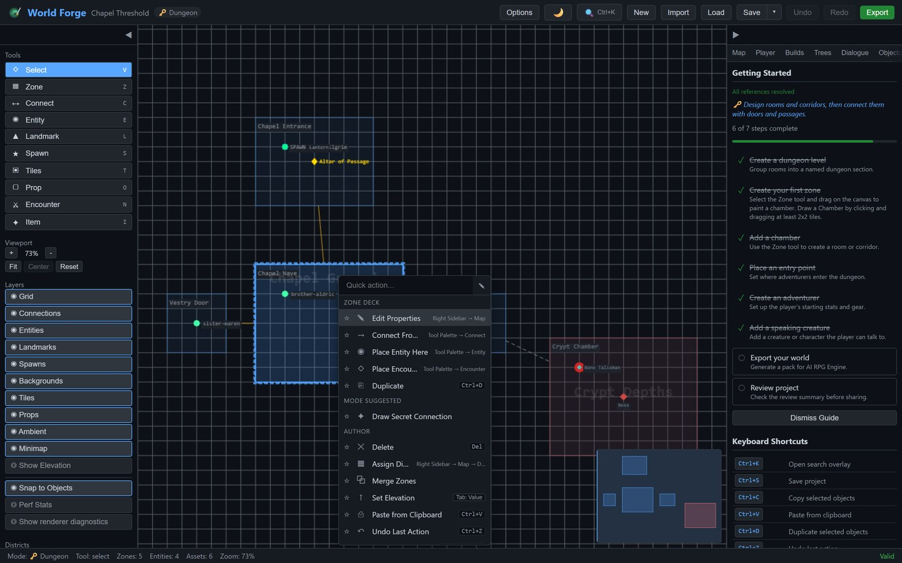

<p align="center">
  <a href="README.md">English</a> | <a href="README.ja.md">日本語</a> | <a href="README.zh.md">中文</a> | <a href="README.es.md">Español</a> | <a href="README.fr.md">Français</a> | <a href="README.hi.md">हिन्दी</a> | <a href="README.it.md">Italiano</a> | <a href="README.pt-BR.md">Português (BR)</a>
</p>

<p align="center">
  
</p>

<p align="center">
  
</p>

<p align="center">
  <a href="https://github.com/mcp-tool-shop-org/world-forge/actions/workflows/ci.yml"></a>
  <a href="https://www.npmjs.com/package/@world-forge/schema"></a>
  <a href="https://opensource.org/licenses/MIT"></a>
  <a href="https://mcp-tool-shop-org.github.io/world-forge/"></a>
</p>

<p align="center">2D / 2.5D world authoring studio with peer export lanes for <a href="https://github.com/mcp-tool-shop-org/ai-rpg-engine">AI RPG Engine</a>, <a href="https://www.unrealengine.com/">Unreal Engine 5</a>, and <a href="https://godotengine.org/">Godot 4</a>.<br>One editor, many modes — paint zones, place entities, define districts, export a complete content pack for your engine of choice.</p>

<!-- version:start -->
<p align="center"><strong>v5.0.0</strong> — 3719 tests, 6 shipping packages, 7 authoring modes, tiles + interiors + town authoring + world modeling (vertical strata, typed hazards, party-gated zones), three export targets (AI RPG Engine, Unreal Engine 5, Godot 4), a measured Forge→Engine content contract, and an authored drawing contract for 2.5D clients</p>
<!-- version:end -->

## Architecture

```
packages/
  schema/          @world-forge/schema         — spatial types, validation, 2.5D fields
  export-ai-rpg/   @world-forge/export-ai-rpg  — AI RPG Engine export pipeline + CLI
  export-unreal/   @world-forge/export-unreal  — Unreal Engine 5 export pipeline + CLI (2.5D aware)
  export-godot/    @world-forge/export-godot   — Godot 4 export pipeline + .tscn scene generation
  renderer-2d/     @world-forge/renderer-2d    — PixiJS 2D canvas renderer
  editor/          @world-forge/editor         — React web authoring app
```

## Quick Start

```bash
npm install
npm run build
npm run dev --workspace=packages/editor
```

Open `http://localhost:5173` to launch the editor.

### Editor Workflow

1. **Choose a mode** — dungeon, district, world, ocean, space, interior, or wilderness — to set grid defaults and connection vocabulary
2. **Start from a kit** — pick a starter kit or genre template from the Template Manager, or start blank
3. **Paint zones** — drag on the canvas to create zones, connect them, assign districts
4. **Place entities** — drop NPCs, enemies, merchants, encounters, and items onto zones
5. **Review** — open the Review tab for health status, content overview, and summary export (Markdown/JSON)
6. **Export** — open the Export modal to inspect per-target readiness (the box shows the worst state across all three targets: red when blocked, amber with listed advisories—including encounter-type translations/drops as well as missing entity placements, no connections on multi-zone projects, missing player template, or missing UE5 elevation or parallax settings—and green when ready with nothing to report), configure target options, then download AI RPG Engine, UE5, or Godot 4 packs. Post-export receipts stack with size, counts, and fidelity details. Also: project bundles (.wfproject.json) and review summaries

### CLI Export

```bash
# AI RPG Engine
npx world-forge-export project.json --out ./my-pack
npx world-forge-export project.json --validate-only
npx world-forge-export --import ./my-pack --out ./round-trip

# Unreal Engine 5
npx world-forge-export-unreal project.json --out ./UnrealPack --sign
npx world-forge-export-unreal --summary ./UnrealPack

# Godot 4 — writes a loadable project root (project.godot + world.tscn)
npx world-forge-export-godot project.json --out ./GodotPack
npx world-forge-export-godot project.json --validate-only
```

## Packages

### @world-forge/schema

Core TypeScript types and validation for world authoring.

- **Spatial types** — `WorldMap`, `Zone`, `ZoneConnection`, `District`, `Landmark`, `SpawnPoint`, `EncounterAnchor`, `FactionPresence`, `PressureHotspot`
- **Content types** — `EntityPlacement`, `ItemPlacement`, `DialogueDefinition`, `PlayerTemplate`, `BuildCatalogDefinition`, `ProgressionTreeDefinition`
- **Visual layers** — `AssetEntry`, `AssetPack`, `Tileset`, `TileLayer`, `PropDefinition`, `PropPlacement`, `AmbientLayer`
- **Town + structures** — `MarketNode`, `CraftingStation`, `Building`, `Hub`, `Stronghold`
- **World modeling** — `Stratum` + `StratumLink` (vertical layers), `HazardDefinition` (typed effects union), `ZoneEntryGate` + party-state `SpawnCondition` operands (`party-level`, `party-size`, `item`, `flag`, `member`, `class`)
- **Mode system** — `AuthoringMode` (7 modes), mode-specific grid/connection/validation profiles
- **Presentation** — optional `WorldPresentation` on `WorldProject`: dimetric view, tile footprint, zone anchor cells, floor plates, and an occupancy row per actor. `presentationAdvisories()` runs eight advisory rules over it, including the one that matters — a person drawn in a room the simulation places them outside of
- **Validation** — `validateProject()` (89 structural checks with Map-based O(n) lookups, `warningCount`), `advisoryValidation()` (mode-specific suggestions, metadata completeness, asset naming). v4.0 JSON that omits later required arrays is accepted after `normalizeProjectShape()` / `stampProjectSchemaVersion()`.
- **Closed unions on the barrel** — `VALID_CONNECTION_KINDS`, `VALID_ASSET_KINDS`, `VALID_ENTITY_ROLES`, `VALID_ITEM_SLOTS`, and the rest of the `VALID_*` sets export from `@world-forge/schema`.
- **Utilities** — `assembleSceneData()` (visual bindings with missing-asset detection), `scanDependencies()` (reference graph analysis), `buildReviewSnapshot()` (health classification)

### @world-forge/export-unreal

Converts a `WorldProject` into an Unreal Engine 5 content pack tuned for 2.5D games.

- **Output** — `pack.json`, per-zone and per-district Primary Data Asset JSON, grouped actor spawn manifest, level-streaming hints per connection, World Partition cell hints, and a structured fidelity report.
- **2.5D fields** — `Zone.elevation`, `elevationRange`, `parallaxLayers`, `skylineRef` are preserved and converted into UE cm / Z-up coordinates.
- **Coordinate transform** — pure functions (`pixelsToUnrealCm`, `elevationToZ`, `worldForgeToUnrealAxis`, `gridToUnrealAxis`). Default world scale is 1 tile = 100 cm.
- **Round-trip import** — `importFromUnreal` reconstructs a WorldProject from an Unreal pack; gameplay-only data (dialogues, progression, builds) is flagged as dropped in the fidelity report.
- **CLI** — `world-forge-export-unreal` with `--out`, `--tile-size-cm`, `--validate-only`, `--verbose`.

### @world-forge/export-godot

Converts a `WorldProject` into a Godot 4 content pack with `.tscn` scene text.

- **Output** — a Godot 4 project root: `project.godot`, `world.tscn` (ExtResource `.tres`), copied textures under `assets/`, `scripts/player.gd`, plus `pack.json` and `fidelity.json`
- **CLI** — `world-forge-export-godot` with `--out`, `--validate-only`, `--include-world-tscn` / `--no-world-tscn`
- **Playable scene** — `buildWorldScene()` emits a navigable `.tscn`: per-zone `StaticBody2D` collision + `NavigationRegion2D`, a framed `Camera2D`, a `CharacterBody2D` player pawn, and y-sort / `z_index` depth
- **Tiles + interiors** — `TileMapLayer` + `TileSet` (baked `tile_map_data` for image tilesets), per-cell wall `StaticBody2D` collision, and prop `Node2D` placements
- **Town** — markets + crafting stations, and buildings (`StaticBody2D` footprints) / hubs / strongholds as `Node2D` placeholders, all carrying their data as metadata
- **World modeling** — vertical strata (per-zone `z_index` banding + `StratumLink` connectors), typed hazards as `Area2D` regions, and zone entry-gate metadata
- **Fidelity reporting** — structured tracking of lossless, approximated, and dropped data, verified against the real Godot 4 engine (headless smoke, 36 assertions)
- **Presentation advisories** — an authored `presentation` block is carried through untouched and its advisories ride on `warnings[]`, so a drawing/sim disagreement is an export finding rather than a surprise on screen
- **Format version** — `GODOT_PACK_FORMAT_VERSION` 1.1.0 (`files`, `zoneGates`, `migrateGodotPack`)

### @world-forge/export-ai-rpg

Converts a `WorldProject` into ai-rpg-engine's `ContentPack` format.

- **Export** — zones, districts, entities, items, dialogues, player template, build catalog, progression trees, encounters (translating World Forge encounter types to the engine's four), factions, hotspots, manifest, and pack metadata
- **Import** — 8 reverse converters reconstruct a WorldProject from exported JSON; CLI `--import` / `--from-pack` write `world-project.json` (or stdout)
- **Fidelity reporting** — structured tracking of what was lossless, approximated, or dropped during conversion; `--out` writes `fidelity.json` beside the pack
- **Format detection** — auto-detects WorldProject, ExportResult, ContentPack, and ProjectBundle formats
- **CLI** — `world-forge-export` with `--out`, `--import`, `--from-pack`, `--validate-only`, `--dry-run`, and `--verbose`

### @world-forge/renderer-2d

PixiJS-based 2D renderer: viewport with pan/zoom, zone overlays with district coloring, connection arrows, entity icons by role, tile layers, and a minimap.

A standalone renderer published for external consumers embedding World Forge data in their own PixiJS app. **The editor does not use it** — the editor's canvas is a direct Canvas2D implementation, so the minimap and viewport features listed under the editor below are its own, not this package's.

### @world-forge/editor

React 19 + Vite web app with Zustand state management, undo/redo with action labels, auto-save (30s throttle, 3-version history, crash recovery), dirty-state guards on all project-loading paths, dark/light theme toggle, modal focus traps, and keyboard-driven tool switching.

#### Workspace Tabs

| Tab | Purpose |
|-----|---------|
| Map | Zone/entity/district editing on the 2D canvas |
| Player | Player template with stats, inventory, equipment, spawn |
| Builds | Archetypes, backgrounds, traits, disciplines, combos |
| Trees | Progression nodes with requirements and effects |
| Dialogue | Node editing, choice linking, broken-ref detection |
| Objects | Hierarchical tree: districts → zones → entities/landmarks/spawns |
| Presets | Region and encounter preset browser with merge/overwrite |
| Assets | Asset library with kind-filtered search, orphan detection, asset packs |
| Issues | Live grouped validation with click-to-focus navigation |
| Deps | Dependency scanner with inline repair buttons |
| Review | Health dashboard, content overview, summary export |
| Guide | First-run checklist with hotkey reference (shown until dismissed) |
| Import | Fidelity report for the last import (shown after an import) |
| Diff | Semantic diff against the imported snapshot (shown after an import) |

#### Canvas & Editing

- **Tools** — 10 tools: select, zone-paint, connection, entity-place, landmark, spawn, tile-paint, prop-place, encounter-place, item-place
- **Multi-select** — shift-click, box-select, Ctrl+A; drag-move with atomic undo
- **Alignment** — 6-way align (left/right/top/bottom/center-h/center-v) and horizontal/vertical distribution
- **Snapping** — drag-time snap to edges/centers of nearby objects with visual guide lines
- **Resize** — 8 handles per zone with edge snapping, min-size clamping, live preview
- **Duplicate** — Ctrl+D with remapped IDs, connections, and district assignments
- **Copy/Paste** — Ctrl+C / Ctrl+V with ID remapping and configurable offset
- **Click-cycle** — repeated clicks at same position cycle through overlapping objects
- **Context menu** — right-click for 7 context-sensitive actions (Edit Properties switches to the Map tab and expands the right sidebar for the selected object including entities, plus delete, duplicate, etc.)
- **Connection preview** — dashed cyan line during connection tool placement
- **Minimap** — 200×150 overview (bottom-right), click to jump
- **Viewport culling** — only renders objects within visible bounds (64px margin)
- **Performance stats** — toggle FPS/object count/render time overlay
- **Per-object visibility** — hide/show individual objects (persisted in localStorage)
- **Layers** — visibility toggles (grid, connections, entities, landmarks, spawns, backgrounds, tiles, props, ambient, elevation; items hit-test with the item layer), plus toggles for the minimap, snap-to-objects, performance stats and renderer diagnostics

#### Navigation & Shortcuts

- **Viewport** — pan/zoom camera, mousewheel zoom (cursor-anchored), spacebar/middle-mouse/right-click drag-pan, fit-to-content when the canvas first opens a project with zones (and on demand from the Speed Panel's Fit to Content), double-click to center
- **Search** — Ctrl+K opens overlay to find any object by name/ID with fuzzy matching, keyboard navigation, and recent search history (localStorage)
- **Speed Panel** — press `Q` (configurable in Options) with the pointer over the canvas (or with the canvas focused, anchored at the selection or centre) or double-right-click to grow the instant single-right-click compact menu in place into the floating command palette, featuring overlapping-target scope chips when two or more visible objects sit under the pointer (`Tab`/`Shift+Tab` on empty search, `ArrowLeft`/`ArrowRight`, or click, with `Canvas` last, a non-mutating canvas highlight outline cleared on close/`Esc`, and polite live-region announcements), a fixed four-band layout on open (an optional per-object **Quick Fix** row displayed visually above Band 1 when problems exist on the target—highlight still starts on Band 1 slot 1 so `Enter` on open runs slot 1, `ArrowDown` order is unchanged, and `Alt+1`–`Alt+5` never shift; reach Quick Fix via `ArrowUp` from slot 1 or by clicking—above a fixed context deck per hit type, copied reorderable pins & macros, toggleable frecency recents, and fixed catalogue groups), tiered search with RPG synonyms, initials, typo tolerance, character highlighting, explained `"Unavailable here"` actions, live hotkey or editor-location badges, inline multi-step pickers (`Quick Fix` repairs and **Show in Issues/Deps/Review** navigation cached per project state, `Assign District` with inline `+ Create District` carrying filter text, `Apply Preset` with `Merge`/`Overwrite`, and `Place Encounter Here` with live AI RPG export compatibility badges; `Backspace` on empty filter or input steps goes Back), `Tab`-activated inline scalar value editing for `Set Elevation`, canvas-delegated spatial picking (`Connect From Here`, typed connections with `Tab` kind cycling and `Shift+Click` target chaining, single-zone `Merge Zones` with `Shift+Click` multi-pick and off-screen zone name search, and `Esc` cancel preserving prior selection untouched), single-entry atomic undo with descriptive labels, **Create Macro from Recent Actions…** from up to 8 in-session replayable steps with atomic single-undo macro execution and inline missing-reference replacement prompts, and **Repeat Last Action Here**
- **Hotkeys** — 29 keyboard shortcuts including tool switching (V/Z/C/E/L/S/T/O/N/I), Enter (open properties in the Map tab and expand the right sidebar), P (apply preset), Shift+P (save preset), Ctrl+C/V (copy/paste), arrow nudge (Shift = 5×)
- **Accessibility** — modal focus traps with Escape-to-close, ARIA labels on all icon-only buttons, keyboard-navigable object tree, screen-reader-announced dirty indicator. Spatial canvas operations (placement, box-select, resize, connection drawing, panning) remain pointer-based

#### Import & Export

- **ContentPack** — target-aware export to AI RPG Engine, Unreal Engine 5, or Godot 4 with per-target readiness badges, configurable options (tile size, scene prefixes, bundle filtering), and post-download receipts
- **Project bundles** — portable `.wfproject.json` files with provenance metadata and dependency info
- **Kit bundles** — `.wfkit.json` export/import with validation, collision handling, and provenance tracking
- **Import** — auto-detects 4 formats with structured fidelity reporting
- **Diff** — semantic change tracking since import
- **Scene preview** — inline HTML/CSS composition of all zone visual bindings

## Authoring Modes

World Forge separates **genre** (fantasy, cyberpunk, pirate) from **mode** (dungeon, ocean, space). Genre is flavor — mode is scale. Mode governs grid defaults, connection vocabulary, validation suggestions, guide wording, and preset filtering.

| Mode | Grid | Tile | Key Connections |
|------|------|------|-----------------|
| Dungeon | 30×25 | 32 | door, stairs, passage, secret, hazard |
| District / City | 50×40 | 32 | road, door, passage, portal |
| Region / World | 80×60 | 48 | road, portal, passage |
| Ocean / Sea | 60×50 | 48 | channel, route, portal, hazard |
| Space | 100×80 | 64 | docking, warp, passage, portal |
| Interior | 20×15 | 24 | door, stairs, passage, secret |
| Wilderness | 60×50 | 48 | trail, road, passage, hazard |

Mode is set when creating a project and stored as `mode?: AuthoringMode` on `WorldProject`. Each mode provides **smart defaults** — connection kinds, entity roles, zone names, and Speed Panel suggestions adapt automatically.

## Authoring Surface

### World Structure

- Zones with spatial layout, neighbors, exits, light, noise, hazards, and interactables
- 12 connection kinds (passage, door, stairs, road, portal, secret, hazard, channel, route, docking, warp, trail) with distinct visual styles, edge-anchored routing, directional arrowheads, and conditional dashed styling
- Districts with faction control, economy profiles, metrics sliders, tags, and district name labels at zone centroids
- Landmarks (named points of interest within zones)
- Spawn points, encounter anchors (type-based coloring), faction presences, and pressure hotspots
- **Vertical strata** — discrete layers (surface / underground / sky, or building floors) with signed order, z-range, inter-layer visibility, and connectors (stairs / ladders / elevators); zones assign to a stratum
- **Typed environmental hazards** — a shared hazard library (damage / status / instakill / ignite effects, trigger timing, terrain move-cost, passability, vision-blocking, weather gating) referenced per zone
- **Zone entry party-gates** — gate entry on party state (level / size / items / flags / members / classes) as a hard or advisory gate with an authored "show the lock" reason
- **Presentation occupancy** — for 2.5D clients: a dimetric view with a tile footprint and span, an anchor cell and optional floor plate per zone, and an occupancy row (character pack, zone, cell, facing) per actor including the player

### Content

- Entity placements with stats, resources, AI profiles, and custom metadata
- Item placements with slot, rarity, stat modifiers, and granted verbs
- Dialogue trees with branching conversations, conditions, and effects
- Encounter anchors on canvas — red diamond markers with boss/ambush/patrol types

### Town & Interiors

- Tile painting — image-backed tilesets (slice by row/col) with a colored-rect fallback, a drag brush, layers, and per-tile "Solid" walkability for wall collision
- Prop placement for interiors (palette + canvas render), with a place tool
- Town economy — market nodes (supply categories, price modifier, contraband) and crafting stations (station type, recipes), edited per zone
- Town structures — buildings (enterable footprints with an interior-zone link), hubs (service + connectivity nodes), and strongholds (fortified faction seats)

### Character Systems

- Player template (starting stats, inventory, equipment, spawn point)
- Build catalog (archetypes, backgrounds, traits, disciplines, cross-titles, entanglements)
- Progression trees (skill/ability nodes with requirements and effects)

### Assets

- Asset manifest (portraits, sprites, backgrounds, icons, tilesets) with kind-specific bindings
- Asset packs (named, versioned groupings with compatibility metadata, theme, license)
- Scene preview (inline composition of all zone visual bindings with missing-asset detection)

### Workflow

- Region presets (9 built-in, mode-filtered) and encounter presets (10 built-in) with merge/overwrite application and custom preset CRUD
- Starter kits (7 built-in, mode-specific) with kit export/import (`.wfkit.json`), optional Speed Panel pin & macro presets (`speedPanelPresets`) merged without overwriting existing user presets, collision handling, and provenance tracking
- Zone merge from the Speed Panel (including interactive canvas zone picking when fewer than 2 zones are selected)
- Layout templates, dialogue templates and batch entity placement (grid/random/circle) exist in the code but are not yet reachable from the editor UI
- Auto-save with 30-second throttle and 3-version recovery history
- Ctrl+K search across all object types with fuzzy matching and recent history
- Speed Panel command palette with overlapping-target scope chips (`Tab`/`Shift+Tab` on empty search, non-mutating canvas highlight, and polite live-region announcements), fixed context decks (and contextual **Quick Fix** row when problems exist on the hit object), copied reorderable favorites, toggleable exponential-decay frecency recents, fixed catalogue groups, tiered RPG synonym/typo search, live keybinding badges, parameterized and recent-action macros (`Create Macro from Recent Actions…` with atomic single undo and missing-ID replacement prompts), custom groups, mode suggestions, inline multi-step and `Tab`-pill inputs, canvas spatial picking with off-screen zone filter and `Tab` connection-kind cycling, AI RPG export advisories, descriptive atomic undo, and **Repeat Last Action Here** (`wf.speedPanel.v2`)
- 29 centralized keyboard shortcuts (including 10 tool-switching keys)
- Project metadata editor (author, license, category, tags)
- Review statistics (role distribution, connection kinds, encounter types, zones per district)
- Export to ContentPack JSON, project bundles, and review summaries
- Import from 4 formats with structured fidelity reporting, repair suggestions, and semantic diff tracking

See [`dogfood/WALKTHROUGH.md`](dogfood/WALKTHROUGH.md) for the Chapel Threshold export handshake proving the current surface.

## Dogfood Directory

The `dogfood/` directory contains an integration test harness that exercises the full authoring-to-export pipeline outside of unit tests. The Chapel Threshold example (`chapel-threshold.ts`) builds a small but complete world project, runs it through export, and writes the output to `dogfood/output/`. This proves that schema types, validation, and the export pipeline work end-to-end with real data — not just isolated mocks.

## Engine Compatibility

Exports target three engines:

- **[ai-rpg-engine](https://github.com/mcp-tool-shop-org/ai-rpg-engine)** — ContentPack format: the deterministic simulation runtime that loads an exported pack and runs the world
- **Unreal Engine 5** — 2.5D-aware content pack with Primary Data Assets, actor spawn manifests, and World Partition hints
- **Godot 4** — `.tscn` scene generation with zone resources, navigation links, and entity manifests

### The Forge→Engine content contract

An exporter that runs is not the same thing as a world that boots. v4.6.0 closes
that gap for the AI RPG Engine lane, and — more usefully — makes the remaining gap
a number instead of an assumption.

- **A measured export table** (`docs/c0-alignment/`) — a leaf-path differ walks
  every authored field and records which ones actually reach the runtime. It is
  generated, checked in, and verified on every test run, so "what survives export"
  is auditable rather than asserted.
- **An honest manifest** — the emitted pack carries a real engine semver range,
  real module ids, a content hash, and compiled exit conditions. Module ids are
  gated on real content: a pack with no crafting stations no longer claims the
  crafting module.
- **The space vocabulary crosses** — per-entity placements with compiled spawn
  conditions, typed hazards, entry gates, and scene descriptors reach the engine's
  content pack, not just the schema.
- **Fidelity reporting stays the contract.** Every lane reports what was lossless,
  approximated, or dropped. Where a field cannot cross, the export says so — it
  does not quietly succeed.
- **Registry sample gate** (`packages/editor/src/__tests__/sample-gate.test.ts`) — dynamically loads every entry from `SAMPLE_WORLDS`, `BUILTIN_KITS`, `GENRE_TEMPLATES`, and `MODE_STARTERS`, asserting store load, `validateProject()`, AI RPG export succeeding with zero encounter blockers (`exportToEngine` + `listAiRpgEncounterBlockers`), full `@ai-rpg-engine/content-schema` validation (`validateGameContent` and `loadContent`), and Unreal Engine 5 (`exportToUnreal`) and Godot 4 (`exportToGodot`) exports.
- **Encounter type translation on AI RPG export** — the AI RPG exporter alone translates World Forge's authoring encounter types to `@ai-rpg-engine/content-schema`'s four (`ambush`, `patrol`, `horde`, `duel`), preserving `worldforge-type:<original>` on `tags[]` and recording an `approximated` fidelity entry (`encounter-type-translated`), leaves `hazard` and `discovery` anchors out of the pack with a `dropped` fidelity entry (`encounter-type-dropped`), and still refuses unmapped custom strings by name:

| World Forge `encounterType` | AI RPG `ContentPack` output | Fidelity & tag |
|---|---|---|
| `boss` | `duel` | `approximated`, `worldforge-type:boss` |
| `beast`, `haunt`, `caravan-raid` | `ambush` | `approximated`, `worldforge-type:<original>` |
| `pirate` | `patrol` | `approximated`, `worldforge-type:pirate` |
| `boarding`, `brawl` | `horde` | `approximated`, `worldforge-type:<original>` |
| `hazard`, `discovery` | omitted from `ContentPack.encounterAnchors` | `dropped` |
| `ambush`, `patrol`, `horde`, `duel` | unchanged | unchanged, no fidelity entry |
| any other custom string | refused (`exportToEngine` returns `success: false` alongside `listAiRpgEncounterBlockers`, CLI exit 1) | blocked |

- **Dialogue speaker IDs on AI RPG export** — `@world-forge/export-ai-rpg` refuses unresolved `dialogues[].speakers` entries by name (`exportToEngine` returns `success: false` with `speakerBlockers` alongside `listAiRpgDialogueSpeakerBlockers`, Export modal blocked, CLI exit `1`), naming both the dialogue ID and the unresolved speaker. A node with `speaker: ''` fills from the dialogue's single listed speaker only when every entity carrying that dialogue (`dialogueId`) is that listed speaker or no entity carries it; it is refused by dialogue ID, node ID, and carrier entity ID when any carrier is a different entity, and refused by dialogue ID and node ID when `dialogues[].speakers` has zero or multiple entries. Non-empty node speakers export unchanged.

Requires `ai-rpg-engine` `^4.0.0`.

**Known gaps against AI RPG Engine 4.0.0** (from a boot test on 2026-11-25). This release's export of the Chapel Threshold sample loads in the published engine, and moving between its zones plays. These parts don't reach play yet:

- **Gated exits.** The engine moves only along `zones[].neighbors`. It drops `zones[].exits` and the pack's `connections` when it loads the pack, so a zone you reach only through a gated exit can't be entered there. In the sample, that's the crypt and the encounter inside it.
- **Custom behaviour profiles.** AI RPG Engine 4.0's `validate` and `sidecar` refuse an `aiProfile` they don't know, by default (`--unresolved-ai-profile fail`). This comes from the engine's 4.0 CLI, not from the boot test, which used only built-in profiles. This exporter writes a built-in profile for every role, so its exports load. An entity you give a custom `ai.profileId` needs a host that registers that profile, or `--unresolved-ai-profile warn`.
- **Dialogues through the sidecar.** The engine's sidecar drops dialogues when it loads the pack. In the boot test they played only through the engine's in-process JSON boot recipe with its load gate turned off; with the gate on, the recipe refused the pack, because the manifest lists modules the recipe doesn't register and adding a player changed the content hash.
- **Other pack data.** The engine drops these when it loads the pack, and names each one with its reason: zone descriptions and hazards, faction presences, pressure hotspots, spawn points, the player template, loot tables, landmarks, strata and stratum links, transitions, crafting stations, market nodes, buildings, hubs, strongholds, the build catalog and progression trees.

### The drawing contract

A world can also say how a client should **draw** it. `WorldProject.presentation`
is optional and additive — most worlds have none and are never penalised for it —
and it holds the dimetric view, the tile footprint, a zone anchor cell and floor
plate per zone, and one occupancy row per actor.

It exists because a 2.5D world is described by three grids at once, and the
export converts between **none** of them:

| Grid | Unit | Owner | Hashed |
|---|---|---|---|
| Sim occupancy | zone id | the engine's `WorldState` | yes — authoritative |
| Dimetric cell | 256x128 diamond, span 3 | the client's view, via `presentation` | never |
| Forge cartesian | `gridX` / `gridY` | the editor and the Godot `.tscn` | never |

A dimetric cell is never derived from `gridX`/`gridY`, and the sandbox scale
skips the block by name so an absolute diamond cell cannot be multiplied by
accident. The sim always wins a dispute about which room a person is in;
`presentationAdvisories()` says so out loud, `exportToGodot` reports it on
`warnings[]`, and the stage-fixture lane can make it fatal with `--strict`.

The block travels on the Godot stage fixture's `pack.json`. It does **not**
travel the `export-ai-rpg` lane — the engine's `ContentPack` has no additive
slot and its loader is strict — and the measured export table reports it as
dropped there rather than implying otherwise.

## Security

- **Data touched:** project files on local disk (user-created JSON), no server-side storage
- **Data NOT touched:** no telemetry, no analytics, no network requests beyond local dev server
- **Permissions:** no API keys, no secrets, no credentials
- **No secrets, tokens, or credentials in source**

## License

MIT

---

Built by [MCP Tool Shop](https://mcp-tool-shop.github.io/)
