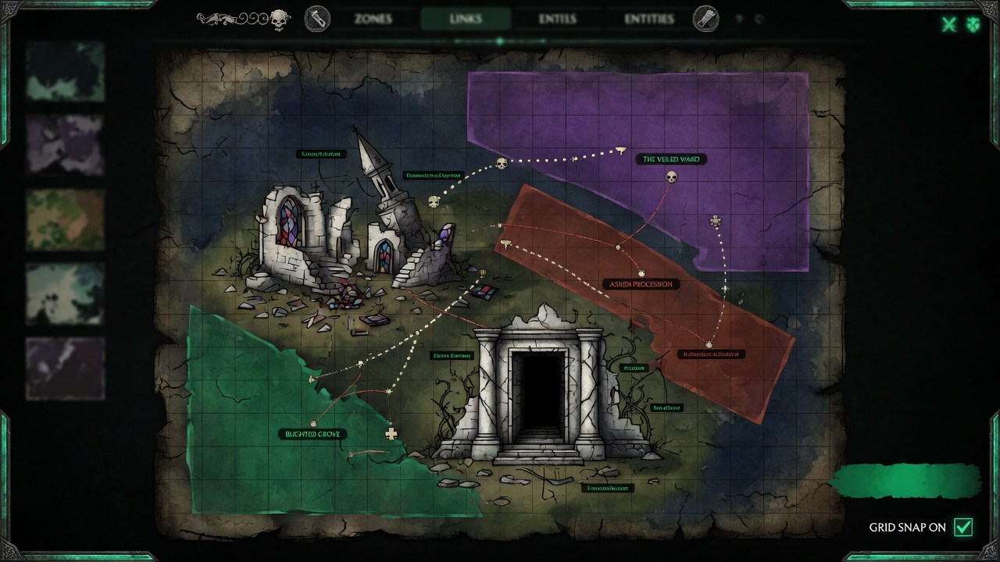

<p align="center">
  <a href="README.ja.md">日本語</a> | <a href="README.md">English</a> | <a href="README.es.md">Español</a> | <a href="README.fr.md">Français</a> | <a href="README.hi.md">हिन्दी</a> | <a href="README.it.md">Italiano</a> | <a href="README.pt-BR.md">Português (BR)</a>
</p>

<p align="center">
  
</p>

<p align="center">
  
</p>

<p align="center">
  <a href="https://github.com/mcp-tool-shop-org/world-forge/actions/workflows/ci.yml"></a>
  <a href="https://www.npmjs.com/package/@world-forge/schema"></a>
  <a href="https://opensource.org/licenses/MIT"></a>
  <a href="https://mcp-tool-shop-org.github.io/world-forge/"></a>
</p>

<p align="center">2D / 2.5D world authoring studio with peer export lanes for <a href="https://github.com/mcp-tool-shop-org/ai-rpg-engine">AI RPG Engine</a>, <a href="https://www.unrealengine.com/">Unreal Engine 5</a>, and <a href="https://godotengine.org/">Godot 4</a>.<br>One editor, many modes — paint zones, place entities, define districts, export a complete content pack for your engine of choice.</p>

<!-- version:start -->
<p align="center"><strong>v4.9.1</strong> — 3475 tests, 6 shipping packages, 7 authoring modes, tiles + interiors + town authoring + world modeling (vertical strata, typed hazards, party-gated zones), three export targets (AI RPG Engine, Unreal Engine 5, Godot 4), a measured Forge→Engine content contract, and an authored drawing contract for 2.5D clients</p>
<!-- version:end -->

## 架构

```
packages/
  schema/          @world-forge/schema         — spatial types, validation, 2.5D fields
  export-ai-rpg/   @world-forge/export-ai-rpg  — AI RPG Engine export pipeline + CLI
  export-unreal/   @world-forge/export-unreal  — Unreal Engine 5 export pipeline + CLI (2.5D aware)
  export-godot/    @world-forge/export-godot   — Godot 4 export pipeline + .tscn scene generation
  renderer-2d/     @world-forge/renderer-2d    — PixiJS 2D canvas renderer
  editor/          @world-forge/editor         — React web authoring app
```

## 快速入门

```bash
npm install
npm run build
npm run dev --workspace=packages/editor
```

打开 `http://localhost:5173` 以启动编辑器。

### 编辑器工作流程

1. **选择模式**——地牢、区域、世界、海洋、空间、室内或荒野——以设置网格默认值和连接词汇。
2. **从一个工具包开始**——从模板管理器中选择一个启动工具包或类型模板，或者从空白开始。
3. **绘制区域**——在画布上拖动以创建区域，连接它们，分配区域。
4. **放置实体**——将 NPC、敌人、商人、遭遇和物品放置到区域中。
5. **审核**——打开“审核”选项卡，查看健康状态、内容概览和摘要导出（Markdown/JSON）。
6. **导出**——打开“导出”对话框，查看每个目标的准备状态（✓ 准备就绪 / ⚠ 提示），配置目标选项，然后下载 AI RPG 引擎、UE5 或 Godot 4 包。导出后的收据会记录大小、数量和保真度详细信息。此外，还有项目包（.wfproject.json）和审核摘要。

### CLI 导出

```bash
# AI RPG Engine
npx world-forge-export project.json --out ./my-pack
npx world-forge-export project.json --validate-only
npx world-forge-export --import ./my-pack --out ./round-trip

# Unreal Engine 5
npx world-forge-export-unreal project.json --out ./UnrealPack --sign
npx world-forge-export-unreal --summary ./UnrealPack

# Godot 4 — writes a loadable project root (project.godot + world.tscn)
npx world-forge-export-godot project.json --out ./GodotPack
npx world-forge-export-godot project.json --validate-only
```

## 包

### @world-forge/schema

用于世界构建的核心 TypeScript 类型和验证。

- **空间类型**——`WorldMap`、`Zone`、`ZoneConnection`、`District`、`Landmark`、`SpawnPoint`、`EncounterAnchor`、`FactionPresence`、`PressureHotspot`
- **内容类型**——`EntityPlacement`、`ItemPlacement`、`DialogueDefinition`、`PlayerTemplate`、`BuildCatalogDefinition`、`ProgressionTreeDefinition`
- **视觉图层**——`AssetEntry`、`AssetPack`、`Tileset`、`TileLayer`、`PropDefinition`、`PropPlacement`、`AmbientLayer`
- **城镇 + 结构**——`MarketNode`、`CraftingStation`、`Building`、`Hub`、`Stronghold`
- **世界建模**——`Stratum` + `StratumLink`（垂直图层）、`HazardDefinition`（类型化效果联合）、`ZoneEntryGate` + 派对状态 `SpawnCondition` 操作数（`party-level`、`party-size`、`item`、`flag`、`member`、`class`）
- **模式系统**——`AuthoringMode`（7 种模式）、特定于模式的网格/连接/验证配置文件
- **呈现**——可选的 `WorldPresentation` 在 `WorldProject` 上：双等距视图、图块占位、区域锚点单元格、楼层平面图以及每个角色的占用行。`presentationAdvisories()` 在其上运行八条建议规则，包括最重要的规则——在房间中绘制的人物，模拟会将他们放置在房间之外。
- **验证**——`validateProject()`（89 个结构检查，使用基于地图的 O(n) 查找，`warningCount`）、`advisoryValidation()`（特定于模式的建议、元数据完整性、资源命名）。在 `normalizeProjectShape()` / `stampProjectSchemaVersion()` 之后，可以接受省略后续所需的数组的 v4.0 JSON。
- **桶上的封闭联合**——`VALID_CONNECTION_KINDS`、`VALID_ASSET_KINDS`、`VALID_ENTITY_ROLES`、`VALID_ITEM_SLOTS` 以及其余 `VALID_*` 集合从 `@world-forge/schema` 导出。
- **实用程序**——`assembleSceneData()`（带有缺失资源检测的视觉绑定）、`scanDependencies()`（引用图分析）、`buildReviewSnapshot()`（健康分类）

### @world-forge/export-unreal

将 `WorldProject` 转换为 Unreal Engine 5 内容包，该包针对 2.5D 游戏进行了优化。

- **输出**——`pack.json`、每个区域和每个区域的主要数据资源 JSON、分组的参与者生成清单、每个连接的关卡流提示、世界分区单元格提示以及结构化的保真度报告。
- **2.5D 字段**——`Zone.elevation`、`elevationRange`、`parallaxLayers`、`skylineRef` 已保留并转换为 UE cm / Z-up 坐标。
- **坐标转换**——纯函数（`pixelsToUnrealCm`、`elevationToZ`、`worldForgeToUnrealAxis`、`gridToUnrealAxis`）。默认世界比例为 1 个图块 = 100 厘米。
- **双向导入**——`importFromUnreal` 从 Unreal 包中重建 WorldProject；仅游戏数据（对话、进度、构建）在保真度报告中标记为已删除。
- **CLI**——`world-forge-export-unreal`，带有 `--out`、`--tile-size-cm`、`--validate-only`、`--verbose`。

### @world-forge/export-godot

将 `WorldProject` 转换为带有 `.tscn` 场景文本的 Godot 4 内容包。

- **输出**——Godot 4 项目根目录：`project.godot`、`world.tscn`（ExtResource `.tres`）、复制到 `assets/`、`scripts/player.gd` 下的纹理，以及 `pack.json` 和 `fidelity.json`。
- **CLI**——`world-forge-export-godot`，带有 `--out`、`--validate-only`、`--include-world-tscn` / `--no-world-tscn`。
- **可玩场景**——`buildWorldScene()` 导出一个可导航的 `.tscn`：每个区域的 `StaticBody2D` 碰撞 + `NavigationRegion2D`、一个框架 `Camera2D`、一个 `CharacterBody2D` 玩家角色以及 y 排序 / `z_index` 深度。
- **图块 + 室内**——`TileMapLayer` + `TileSet`（烘焙 `tile_map_data` 用于图像图块集）、每个单元格的墙壁 `StaticBody2D` 碰撞以及道具 `Node2D` 放置。
- **城镇**——市场 + 制作站，以及建筑物（`StaticBody2D` 占位）/枢纽/据点作为 `Node2D` 占位符，所有这些都将其数据作为元数据携带。
- **世界建模**——垂直层（每个区域的 `z_index` 划分 + `StratumLink` 连接器）、类型化的危险作为 `Area2D` 区域以及区域入口门元数据。
- **保真度报告**——结构化跟踪无损、近似和删除的数据，并与真实的 Godot 4 引擎进行验证（无头烟雾、36 个断言）。
- **呈现建议**——授权的 `presentation` 块会完整地传递，并且其建议会与 `warnings[]` 关联，因此绘制/模拟不一致是一个导出结果，而不是屏幕上的意外情况。
- **格式版本**——`GODOT_PACK_FORMAT_VERSION` 1.1.0（`files`、`zoneGates`、`migrateGodotPack`）

### @world-forge/export-ai-rpg

将 `WorldProject` 转换为 ai-rpg-engine 的 `ContentPack` 格式。

- **导出**——区域、区域、实体、物品、对话、玩家模板、构建目录、进度树、遭遇、派系、热点、清单和包元数据。
- **导入**——8 个反向转换器从导出的 JSON 中重建 WorldProject；CLI `--import` / `--from-pack` 写入 `world-project.json`（或标准输出）。
- **保真度报告**——结构化跟踪在转换期间哪些数据是无损的、近似的或已删除的；`--out` 将 `fidelity.json` 写入包旁边。
- **格式检测**——自动检测 WorldProject、ExportResult、ContentPack 和 ProjectBundle 格式。
- **CLI**——`world-forge-export`，带有 `--out`、`--import`、`--from-pack`、`--validate-only`、`--dry-run` 和 `--verbose`。

### @world-forge/renderer-2d

基于 PixiJS 的 2D 渲染器：带有平移/缩放的视口、带有区域着色的区域叠加层、按角色的连接箭头、实体图标、图块图层和一个小地图。

一个独立的渲染器，供外部用户发布，以便将 World Forge 数据嵌入到他们自己的 PixiJS 应用程序中。**编辑器不使用它**——编辑器的画布是一个直接的 Canvas2D 实现，因此下面列出的编辑器的迷你地图和视口功能是它自己的，而不是此包的功能。

### @world-forge/editor

React 19 + Vite Web 应用程序，带有 Zustand 状态管理、带有操作标签的撤销/重做、自动保存（30 秒节流，3 个版本历史记录，崩溃恢复）、所有项目加载路径上的脏状态保护、深色/浅色主题切换、模态焦点陷阱以及基于键盘的工具切换。

#### 工作区选项卡

| 选项卡 | 用途 |
|-----|---------|
| 地图 | 在 2D 画布上编辑区域/实体/区域 |
| 对象 | 分层树：区域 → 区域 → 实体/地标/生成点 |
| 玩家 | 带有属性、物品栏、装备和生成点的玩家模板 |
| 构建 | 原型、背景、特征、技能、组合 |
| 树 | 带有要求和效果的进度节点 |
| 对话 | 节点编辑、选项链接、断开引用检测 |
| 预设 | 区域和遭遇预设浏览器，支持合并/覆盖 |
| 资源 | 资源库，支持按类型筛选搜索、检测孤立资源、资源包 |
| 问题 | 实时分组验证，点击可聚焦导航 |
| 依赖项 | 依赖项扫描器，带有内联修复按钮 |
| 审核 | 健康仪表板、内容概览、摘要导出 |
| 指南 | 首次运行检查清单，带有快捷键参考 |

#### 画布和编辑

- **工具** — 选择、区域绘制、连接、实体放置、地标、生成点、物品放置、遭遇放置
- **多选** — 按住 Shift 键点击、框选、Ctrl+A；拖动移动，支持原子撤销
- **对齐** — 6 种对齐方式（左/右/上/下/水平居中/垂直居中）以及水平/垂直分布
- **吸附** — 拖动时吸附到附近对象的边缘/中心，并带有视觉引导线
- **调整大小** — 每个区域有 8 个控制点，支持边缘吸附、最小尺寸限制、实时预览
- **复制** — Ctrl+D，重新映射 ID、连接和区域分配
- **复制/粘贴** — Ctrl+C / Ctrl+V，重新映射 ID，并可配置偏移量
- **循环点击** — 在同一位置重复点击，循环显示重叠的对象
- **上下文菜单** — 右键单击，显示 7 个上下文相关的操作（属性、删除、复制等）
- **连接预览** — 在连接工具放置时显示虚线青色线条
- **小地图** — 200×150 概览（右下角），点击可跳转
- **视口裁剪** — 仅渲染可见区域内的对象（64 像素边距）
- **性能统计** — 切换显示 FPS/对象数量/渲染时间叠加层
- **每个对象的可见性** — 隐藏/显示单个对象（在 localStorage 中持久保存）
- **图层** — 可见性切换（网格、连接、实体、地标、生成点、城镇、图块、道具、环境；物品与物品图层进行碰撞检测）

#### 导航和快捷键

- **视口** — 移动/缩放相机，鼠标滚轮缩放（光标锚定），空格键/鼠标中键/右键单击拖动移动，自动适应内容，双击居中
- **搜索** — Ctrl+K 打开叠加层，按名称/ID 查找任何对象，支持模糊匹配、键盘导航和最近搜索历史记录（localStorage）
- **速度面板** — 双击右键，显示一个浮动命令面板，其中包含上下文相关的操作、可固定收藏夹、宏和模式建议的快速操作
- **快捷键** — 21 个键盘快捷键，包括工具切换（V/Z/C/E/L/S）、Enter（打开详细信息）、P（应用预设）、Shift+P（保存预设）、Ctrl+C/V（复制/粘贴）、箭头微调（Shift = 5 倍）
- **辅助功能** — 模态焦点陷阱，按 Esc 键关闭，所有仅图标按钮都有 ARIA 标签，键盘可导航的对象树，屏幕阅读器会播报脏标志。空间画布操作（放置、框选、调整大小、连接绘制、平移）仍然基于指针

#### 导入和导出

- **ContentPack** — 目标感知导出，导出到 AI RPG 引擎、Unreal Engine 5 或 Godot 4，带有每个目标的就绪状态徽章、可配置的选项（图块大小、场景前缀、包过滤）和下载后收据
- **项目包** — 可移植的 `.wfproject.json` 文件，带有来源元数据和依赖项信息
- **工具包** — `.wfkit.json` 导出/导入，带有验证、碰撞处理和来源跟踪
- **导入** — 自动检测 4 种格式，并提供结构化的保真度报告
- **差异** — 自导入以来的语义更改跟踪
- **场景预览** — 所有区域视觉绑定的内联 HTML/CSS 组合

## 创作模式

World Forge 将 **类型**（奇幻、赛博朋克、海盗）与 **模式**（地牢、海洋、太空）区分开。类型是风格，模式是规模。模式控制网格默认值、连接词汇、验证建议、指南措辞和预设过滤。

| 模式 | 网格 | 图块 | 关键连接 |
|------|------|------|-----------------|
| 地牢 | 30×25 | 32 | 门、楼梯、通道、秘密、危险 |
| 区域/城市 | 50×40 | 32 | 道路、门、通道、传送门 |
| 区域/世界 | 80×60 | 48 | 道路、传送门、通道 |
| 海洋/海洋 | 60×50 | 48 | 水道、路线、传送门、危险 |
| 太空 | 100×80 | 64 | 对接、曲速、通道、传送门 |
| 室内 | 20×15 | 24 | 门、楼梯、通道、秘密 |
| 荒野 | 60×50 | 48 | 小路、道路、通道、危险 |

模式在创建项目时设置，并作为 `mode?: AuthoringMode` 存储在 `WorldProject` 中。每种模式都提供 **智能默认值** — 连接类型、实体角色、区域名称和速度面板建议会自动调整。

## 创作表面

### 世界结构

- 具有空间布局、相邻区域、出口、光照、噪音、危险因素和可交互对象的区域
- 12 种连接类型（通道、门、楼梯、道路、传送门、秘密通道、危险区域、通道、路线、对接点、传送点、小路），具有不同的视觉风格、边缘锚定路由、方向箭头和有条件虚线样式
- 具有派系控制、经济概况、指标滑块、标签和区域中心点的区域名称标签的区域
- 地标（区域内的命名兴趣点）
- 生成点、遭遇锚点（基于类型的颜色标记）、派系存在和压力热点
- **垂直分层**——离散的层（表面/地下/天空，或建筑物楼层），具有带符号的顺序、z 范围、层间可见性和连接器（楼梯/梯子/电梯）；区域分配到某个分层
- **类型的环境危险**——共享的危险库（伤害/状态/即死/点燃效果、触发时间、地形移动成本、可通行性、视野阻挡、天气限制），每个区域引用
- **区域入口通行门**——基于队伍状态（等级/规模/物品/标志/成员/职业）的入口通行门，作为强制或建议的通行门，并带有作者编写的“显示锁”理由
- **表现形式占用**——对于 2.5D 客户端：具有瓷砖占位和跨度的等距视图、每个区域的锚定单元和可选的楼板，以及每个角色（包括玩家）的占用行（角色包、区域、单元、朝向）

### 内容

- 具有属性、资源、AI 概况和自定义元数据的实体放置
- 具有插槽、稀有度、属性修改器和授予的动作的物品放置
- 具有分支对话、条件和效果的对话树
- 位于画布上的遭遇锚点——带有 Boss/伏击/巡逻类型的红色菱形标记

### 城镇和内部空间

- 瓷砖绘制——基于图像的瓷砖集（按行/列切片），具有彩色矩形回退、拖动画笔、图层和每个瓷砖的“固体”可通行性，用于墙壁碰撞
- 内部空间的道具放置（调色板 + 画布渲染），带有放置工具
- 城镇经济——市场节点（供应类别、价格修改器、违禁品）和制作站（站类型、配方），每个区域进行编辑
- 城镇结构——建筑物（具有内部区域链接的可进入占位）、枢纽（服务 + 连接节点）和据点（加强的派系据点）

### 角色系统

- 玩家模板（起始属性、物品栏、装备、生成点）
- 构建目录（原型、背景、特征、学科、交叉职称、关联）
- 进度树（具有要求和效果的技能/能力节点）

### 资源

- 资源清单（肖像、精灵、背景、图标、瓷砖集），具有特定于类型的绑定
- 资源包（命名、版本化的分组，具有兼容性元数据、主题、许可证）
- 场景预览（所有区域视觉绑定的内联组合，具有缺失资源检测）

### 工作流程

- 区域预设（9 个内置，按模式过滤）和遭遇预设（10 个内置），具有合并/覆盖应用和自定义预设的创建/读取/更新/删除功能
- 启动工具包（7 个内置，特定于模式），具有工具包导出/导入（`.wfkit.json`）、碰撞处理和来源跟踪
- 布局模板（6 个预构建的区域布局）和对话模板（5 个对话开场白）
- 区域合并和批量实体放置（网格/随机/圆形模式）
- 自动保存，30 秒延迟和 3 个版本的恢复历史
- Ctrl+K 搜索所有对象类型，具有模糊匹配和最近历史记录
- 速度面板命令调色板，具有可固定收藏夹、宏、自定义组和模式建议
- 21 个集中的键盘快捷键（包括 6 个工具切换键）
- 项目元数据编辑器（作者、许可证、类别、标签）
- 审查统计信息（角色分布、连接类型、遭遇类型、每个区域的区域数量）
- 导出到 ContentPack JSON、项目包和审查摘要
- 从 4 种格式导入，具有结构化保真度报告、修复建议和语义差异跟踪

请参阅 [`dogfood/WALKTHROUGH.md`](dogfood/WALKTHROUGH.md)，了解 Chapel Threshold 导出握手，以证明当前的表面。

## 内部测试目录

`dogfood/` 目录包含一个集成测试框架，该框架在单元测试之外执行完整的从创作到导出的流水线。Chapel Threshold 示例（`chapel-threshold.ts`）构建一个小型但完整的世界项目，将其运行通过导出，并将输出写入 `dogfood/output/`。这证明了模式类型、验证和导出流水线是否能够端到端地使用真实数据工作——而不仅仅是孤立的模拟。

## 引擎兼容性

导出目标是三个引擎：

- **[ai-rpg-engine](https://github.com/mcp-tool-shop-org/ai-rpg-engine)** — ContentPack 格式：确定性模拟运行时，它加载导出的包并运行世界
- **虚幻引擎 5** — 具有主要数据资源、角色生成清单和世界分区提示的 2.5D 感知的资源包
- **Godot 4** — `.tscn` 场景生成，具有区域资源、导航链接和实体清单

### Forge→引擎内容契约

运行的导出器与启动的世界并不相同。v4.6.0 弥合了 AI RPG 引擎通道中的差距，并且——更重要的是——使剩余的差距成为一个数字，而不是一个假设。

- **一种经过测量的导出表** (`docs/c0-alignment/`)——一种叶路径差异算法，它会遍历每个已编写的字段，并记录哪些字段实际上会传递到运行时。它会在每次测试运行时生成、签入和验证，因此“导出后保留的内容”是可以审计的，而不是简单地声明。
- **一份诚实的事实清单**——导出的包包含真实的引擎语义版本范围、真实的模块 ID、内容哈希以及编译后的退出条件。模块 ID 与实际内容相关联：不包含制作站的包将不再声明包含制作模块。
- **空间词汇的交叉**——每个实体的放置位置，以及编译后的生成条件、类型的危险因素、入口门和场景描述符，都会传递到引擎的内容包中，而不仅仅是模式。
- **保真度报告始终如一。** 每个通道都会报告哪些内容是无损的、近似的或已删除的。如果某个字段无法传递，导出表会明确说明——它不会悄悄地成功。

需要 `ai-rpg-engine` `^3.8.0`。

### 绘图协议

一个世界还可以指定客户端应该如何**绘制**它。 `WorldProject.presentation` 是可选的，并且是附加的——大多数世界都没有它，也不会因此受到惩罚——它包含等距视图、图块占位、每个区域的区域锚定单元格和地板平面，以及每个角色的一个占用行。

它存在的原因是，一个 2.5D 世界同时由三个网格描述，并且导出过程不会在它们之间进行转换：

| 网格 | 单元 | 所有者 | 已哈希 |
|---|---|---|---|
| 模拟占用 | 区域 ID | 引擎的 `WorldState` | 是——权威 |
| 等距单元格 | 256x128 菱形，跨度为 3 | 客户端的视图，通过 `presentation` | 永远不会 |
| 锻造笛卡尔坐标 | `gridX` / `gridY` | 编辑器和 Godot 引擎的 `.tscn` | 永远不会 |

等距单元格永远不会从 `gridX`/`gridY` 派生，并且沙盒缩放会跳过该块，因此绝对的菱形单元格不会意外地被乘法。在关于某人位于哪个房间的争论中，模拟始终获胜；`presentationAdvisories()` 会大声说出来，`exportToGodot` 会在 `warnings[]` 上报告，并且阶段固定通道可以使用 `--strict` 使其致命。

该块在 Godot 阶段固定的 `pack.json` 上移动。它**不会**通过 `export-ai-rpg` 通道移动——引擎的 `ContentPack` 没有附加插槽，并且其加载器是严格的——并且经过测量的导出表会报告它在那里被删除，而不是暗示其他情况。

## 安全性

- **涉及的数据：**本地磁盘上的项目文件（用户创建的 JSON），没有服务器端存储
- **不涉及的数据：**没有遥测数据、没有分析数据、没有超出本地开发服务器的网络请求
- **权限：**没有 API 密钥、没有密钥、没有凭据
- **源代码中不包含任何密钥、令牌或凭据**

## 许可证

MIT

---

由 [MCP Tool Shop](https://mcp-tool-shop.github.io/) 构建
